# Серия 02 «НЕ СЛУШАЙ ЕГО» — раскадровка и shot list

Хронометраж: 62.40 с · 1080×1920 · 60 fps · 20 планов · кадры взяты из renders/ep02/ep02_picture_master.mp4

## S01 · 00:00.00–00:03.20 (3.2 с) — Коридор: двойник выходит из темноты; шёпот Армана «Ты… это я?»

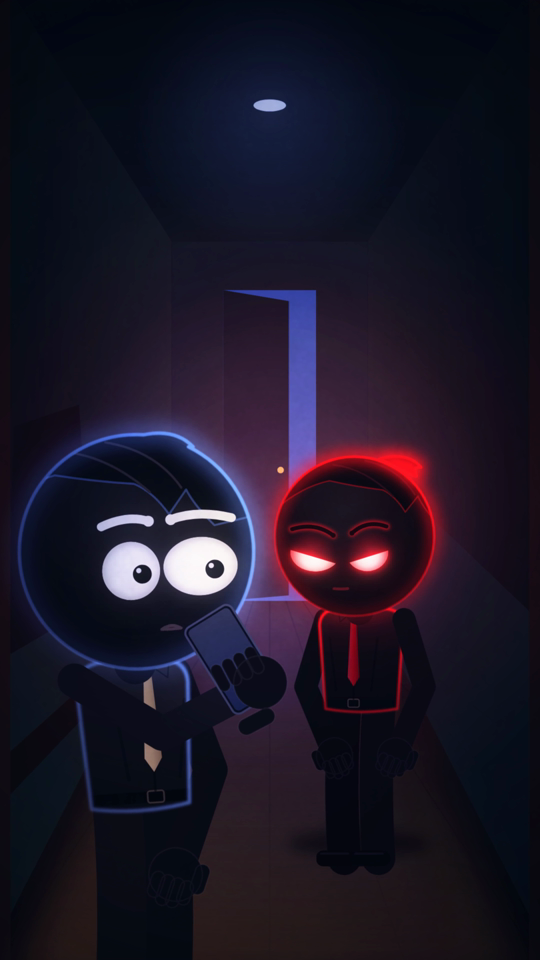

- **Локация:** Коридор
- **Персонажи:** Арман, Двойник
- **План:** средний двухшотовый · **Камера:** из глубины коридора · **Движение:** медленный наезд
- **Действие:** Двойник выходит из темноты; Арман шепчет «Ты… это я?»
- **Эмоции:** оцепенение
- **Диалог:** arman: Ты… это я?
- **Звук:** шаг, гул, комнатный тон
- **Свет:** холодный синий + красный ореол двойника
- **Переход:** из конца серии 1
- **Способ:** процедурная 2.5D-анимация (skia, риг scripts/engine/rig2.py, стандарт серии), нативные 60 fps · **Исходник:** `scripts/ep02_shots.py::s01`

## S02 · 00:03.20–00:06.40 (3.2 с) — СКП двойника: «Видишь? Опять… первым.» — указывает на телефон

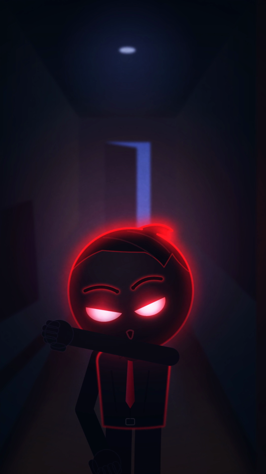

- **Локация:** Коридор
- **Персонажи:** Двойник
- **План:** СКП · **Камера:** через плечо Армана · **Движение:** лёгкий наезд
- **Действие:** Двойник указывает на телефон: «Видишь? Опять… первым.»
- **Эмоции:** холодная уверенность
- **Диалог:** double: Видишь? Опять… первым.
- **Звук:** вибро телефона
- **Свет:** холодный, красный контур
- **Переход:** склейка по действию
- **Способ:** процедурная 2.5D-анимация (skia, риг scripts/engine/rig2.py, стандарт серии), нативные 60 fps · **Исходник:** `scripts/ep02_shots.py::s02`

## S03 · 00:06.40–00:09.40 (3.0 с) — Инсерт чат: «НЕ СЛУШАЙ ЕГО. ОН ХОЧЕТ ЗАНЯТЬ ТВОЁ МЕСТО.»

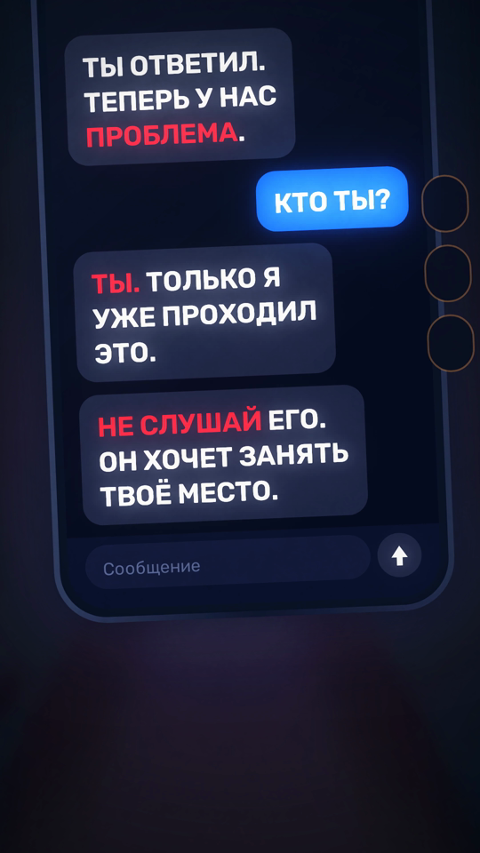

- **Локация:** Инсерт
- **Персонажи:** телефон
- **План:** деталь · **Камера:** сверху · **Движение:** микро-наезд, вибрация
- **Действие:** Новое сообщение: «НЕ СЛУШАЙ ЕГО. ОН ХОЧЕТ ЗАНЯТЬ ТВОЁ МЕСТО.»
- **Эмоции:** угроза
- **Диалог:** —
- **Звук:** вибро, поп
- **Свет:** экран, расфокус коридора
- **Переход:** склейка
- **Способ:** процедурная 2.5D-анимация (skia, риг scripts/engine/rig2.py, стандарт серии), нативные 60 fps · **Исходник:** `scripts/ep02_shots.py::s03`

## S04 · 00:09.40–00:12.40 (3.0 с) — КП Армана: «Тогда кто из вас… мне пишет?»

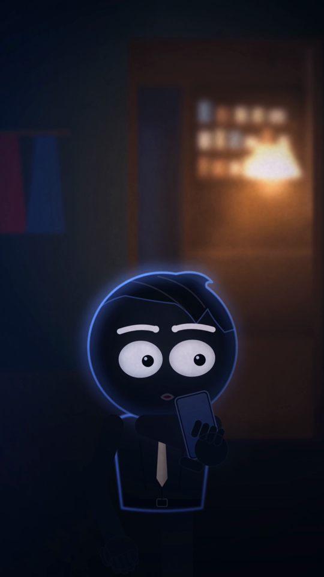

- **Локация:** Коридор
- **Персонажи:** Арман
- **План:** КП · **Камера:** фронтально · **Движение:** медленный наезд
- **Действие:** «Тогда кто из вас… мне пишет?»
- **Эмоции:** растерянность, страх
- **Диалог:** arman: Тогда кто из вас… мне пишет?
- **Звук:** комнатный тон
- **Свет:** холодный, синий контур
- **Переход:** склейка
- **Способ:** процедурная 2.5D-анимация (skia, риг scripts/engine/rig2.py, стандарт серии), нативные 60 fps · **Исходник:** `scripts/ep02_shots.py::s04`

## S05 · 00:12.40–00:17.20 (4.8 с) — КП двойника: «Я — это ты. Только я… уже ответил.»

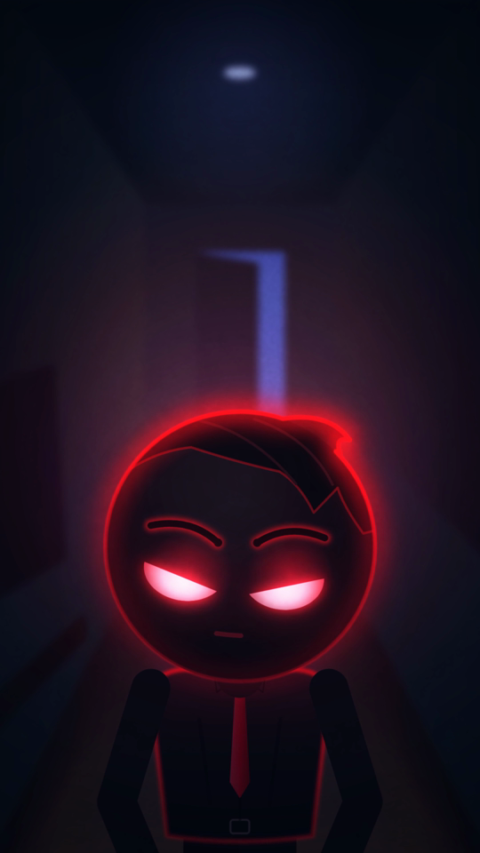

- **Локация:** Коридор
- **Персонажи:** Двойник
- **План:** КП · **Камера:** через плечо Армана · **Движение:** медленный наезд
- **Действие:** «Я — это ты. Только я… уже ответил.»
- **Эмоции:** спокойная угроза
- **Диалог:** double: Я — это ты. Только я… уже ответил.
- **Звук:** пульс музыки
- **Свет:** красный ореол
- **Переход:** склейка
- **Способ:** процедурная 2.5D-анимация (skia, риг scripts/engine/rig2.py, стандарт серии), нативные 60 fps · **Исходник:** `scripts/ep02_shots.py::s05`

## S06 · 00:17.20–00:19.80 (2.6 с) — Двойник кивает в сторону кухни: «Посмотри на часы.»

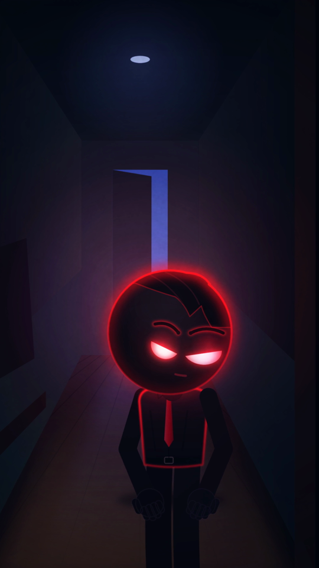

- **Локация:** Коридор
- **Персонажи:** Двойник, Арман
- **План:** средний · **Камера:** сбоку · **Движение:** статично
- **Действие:** Двойник кивает в сторону кухни: «Посмотри на часы.»
- **Эмоции:** намёк
- **Диалог:** double: Посмотри на часы.
- **Звук:** тиканье вдали
- **Свет:** холодный + тёплая полоса из кухни
- **Переход:** склейка по взгляду
- **Способ:** процедурная 2.5D-анимация (skia, риг scripts/engine/rig2.py, стандарт серии), нативные 60 fps · **Исходник:** `scripts/ep02_shots.py::s06`

## S07 · 00:19.80–00:24.00 (4.2 с) — Инсерт часы: 23:17:59 → 23:18 → откат на 23:17; «Каждую ночь.»

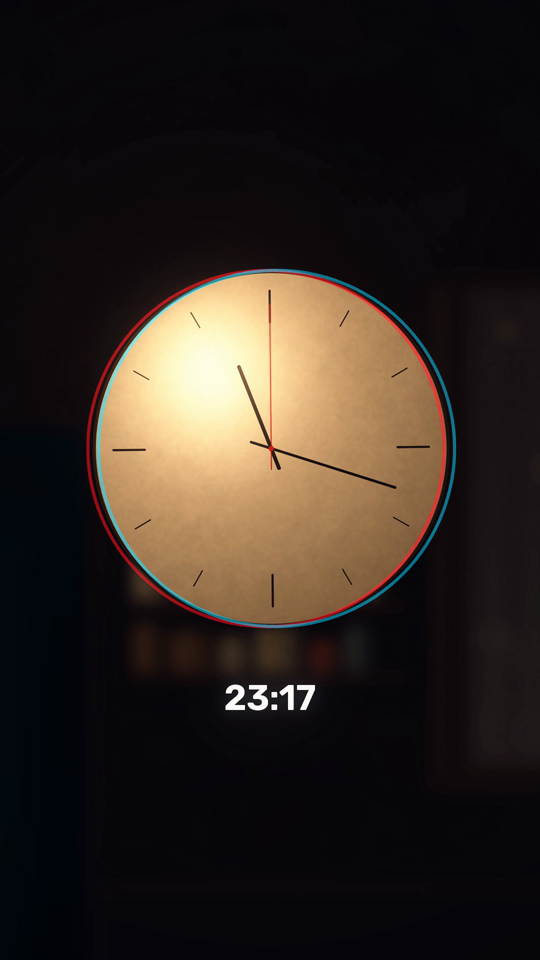

- **Локация:** Инсерт
- **Персонажи:** настенные часы
- **План:** деталь · **Камера:** фронтально · **Движение:** микро-наезд
- **Действие:** 23:17:59 → 23:18 → откат на 23:17; голос за кадром «Каждую ночь.»
- **Эмоции:** петля времени
- **Диалог:** double: 23:17. Каждую ночь.
- **Звук:** громкое тиканье, глитч, реверс
- **Свет:** тёплый кухонный
- **Переход:** склейка
- **Способ:** процедурная 2.5D-анимация (skia, риг scripts/engine/rig2.py, стандарт серии), нативные 60 fps · **Исходник:** `scripts/ep02_shots.py::s07`

## S08 · 00:24.00–00:26.60 (2.6 с) — ДКП Армана: осознание, лампа на кухне мигает

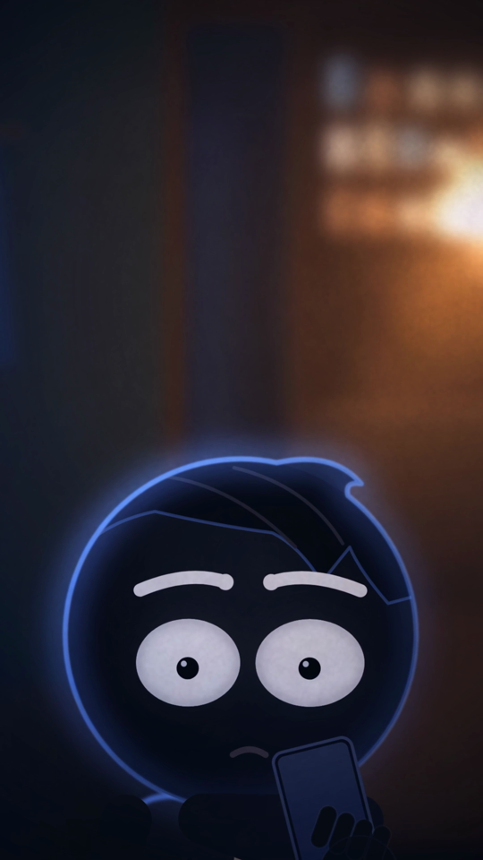

- **Локация:** Коридор
- **Персонажи:** Арман
- **План:** ДКП · **Камера:** фронтально · **Движение:** медленный наезд
- **Действие:** Осознание; лампа на кухне плавно мигает (≤3 провала/с)
- **Эмоции:** ужас
- **Диалог:** —
- **Звук:** гул лампы
- **Свет:** холодный + мигание
- **Переход:** склейка
- **Способ:** процедурная 2.5D-анимация (skia, риг scripts/engine/rig2.py, стандарт серии), нативные 60 fps · **Исходник:** `scripts/ep02_shots.py::s08`

## S09 · 00:26.60–00:29.60 (3.0 с) — Инсерт: входящий «МАМА»

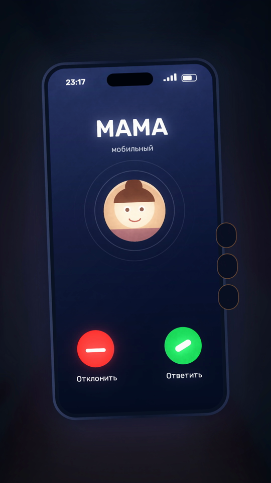

- **Локация:** Инсерт
- **Персонажи:** телефон
- **План:** деталь · **Камера:** сверху · **Движение:** вибрация
- **Действие:** Входящий «МАМА»
- **Эмоции:** шок
- **Диалог:** —
- **Звук:** рингтон, вибро
- **Свет:** экран
- **Переход:** склейка
- **Способ:** процедурная 2.5D-анимация (skia, риг scripts/engine/rig2.py, стандарт серии), нативные 60 fps · **Исходник:** `scripts/ep02_shots.py::s09`

## S10 · 00:29.60–00:32.00 (2.4 с) — КП двойника: «Не отвечай.»

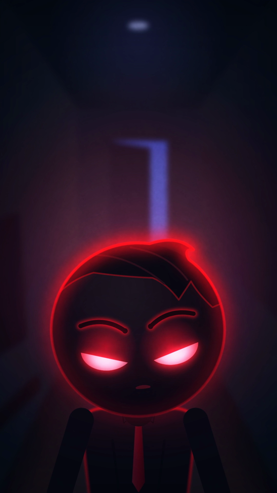

- **Локация:** Коридор
- **Персонажи:** Двойник
- **План:** КП · **Камера:** через плечо Армана · **Движение:** статично
- **Действие:** «Не отвечай.»
- **Эмоции:** приказ
- **Диалог:** double: Не отвечай.
- **Звук:** рингтон (приглушён под репликой)
- **Свет:** красный ореол, мигание
- **Переход:** склейка
- **Способ:** процедурная 2.5D-анимация (skia, риг scripts/engine/rig2.py, стандарт серии), нативные 60 fps · **Исходник:** `scripts/ep02_shots.py::s10`

## S11 · 00:32.00–00:34.00 (2.0 с) — Инсерт: Арман всё равно отвечает

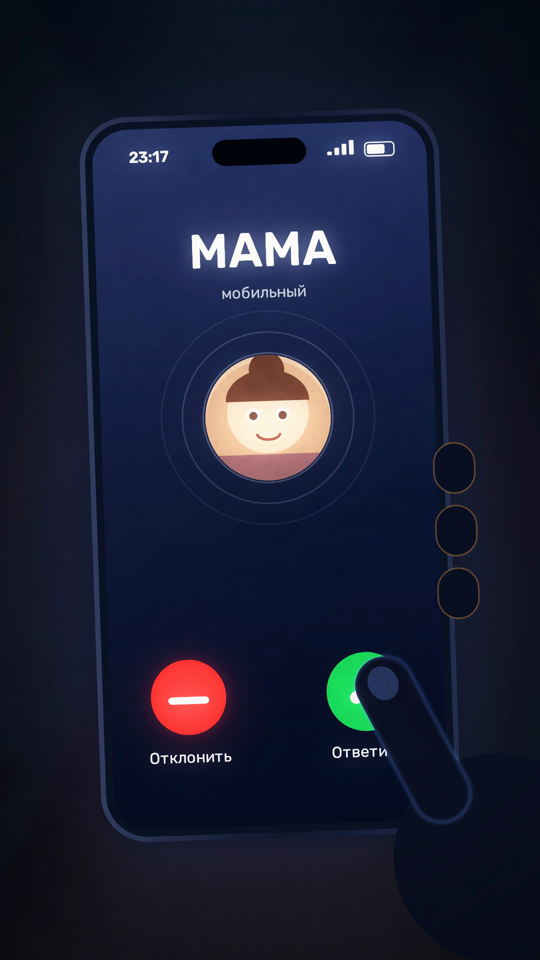

- **Локация:** Инсерт
- **Персонажи:** телефон, палец
- **План:** деталь · **Камера:** сверху · **Движение:** статично
- **Действие:** Арман всё равно нажимает «Ответить»
- **Эмоции:** решимость
- **Диалог:** —
- **Звук:** тап, рингтон обрывается
- **Свет:** экран
- **Переход:** склейка
- **Способ:** процедурная 2.5D-анимация (skia, риг scripts/engine/rig2.py, стандарт серии), нативные 60 fps · **Исходник:** `scripts/ep02_shots.py::s11`

## S12 · 00:34.00–00:38.60 (4.6 с) — Арман с телефоном у уха; оглядывается — коридор пуст

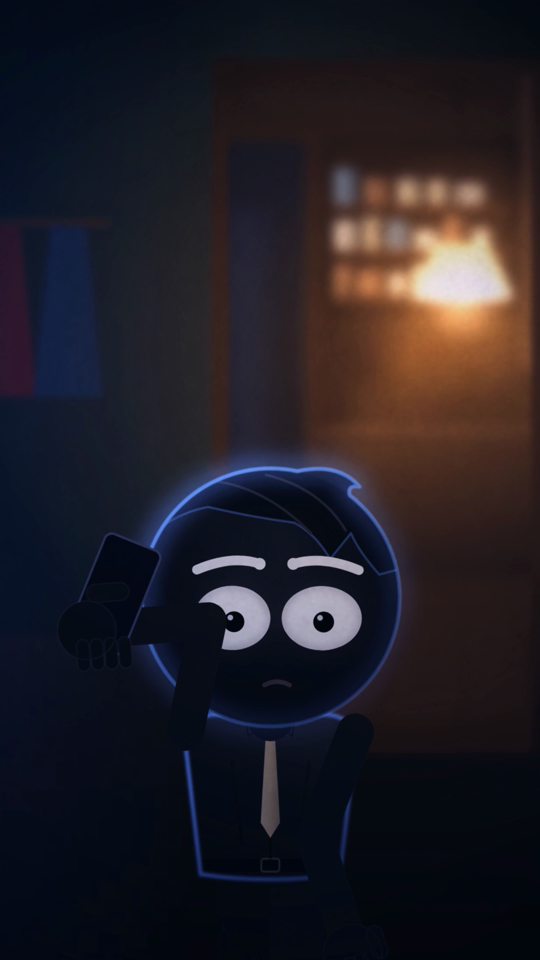

- **Локация:** Коридор
- **Персонажи:** Арман
- **План:** средний · **Камера:** фронтально · **Движение:** медленный наезд
- **Действие:** Телефон у уха; мама: «Арман? Ты почему не спишь?»; оглядывается — коридор пуст
- **Эмоции:** облегчение → тревога
- **Диалог:** mom_phone: Арман? Ты почему не спишь?
- **Звук:** голос в трубке, свуш исчезновения
- **Свет:** холодный
- **Переход:** склейка
- **Способ:** процедурная 2.5D-анимация (skia, риг scripts/engine/rig2.py, стандарт серии), нативные 60 fps · **Исходник:** `scripts/ep02_shots.py::s12`

## S13 · 00:38.60–00:41.20 (2.6 с) — КП Армана: «Мам… ты где сейчас?»

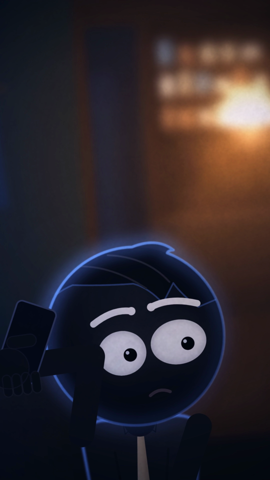

- **Локация:** Коридор
- **Персонажи:** Арман
- **План:** КП · **Камера:** фронтально · **Движение:** статично
- **Действие:** «Мам… ты где сейчас?»
- **Эмоции:** страх
- **Диалог:** arman: Мам… ты где сейчас?
- **Звук:** комнатный тон
- **Свет:** холодный, синий контур
- **Переход:** склейка
- **Способ:** процедурная 2.5D-анимация (skia, риг scripts/engine/rig2.py, стандарт серии), нативные 60 fps · **Исходник:** `scripts/ep02_shots.py::s13`

## S14 · 00:41.20–00:44.60 (3.4 с) — Арман медленно поворачивается к свету кухни: «Дома. На кухне. Иди сюда.»

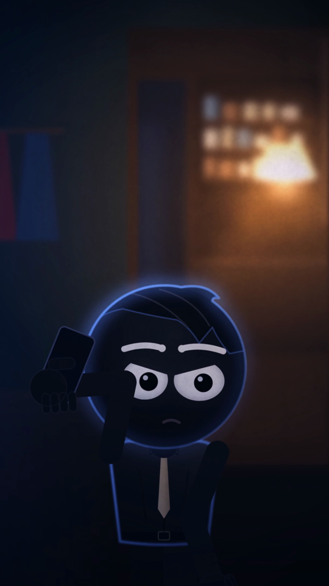

- **Локация:** Коридор → кухня
- **Персонажи:** Арман
- **План:** средний · **Камера:** сзади-сбоку · **Движение:** панорама за поворотом
- **Действие:** Медленно поворачивается к свету кухни; мама в трубке: «Дома. На кухне. Иди сюда.»
- **Эмоции:** тревожное ожидание
- **Диалог:** mom_phone: Дома. На кухне. Иди сюда.
- **Звук:** голос в трубке, сброс вызова
- **Свет:** холодный → тёплый янтарь
- **Переход:** склейка по движению
- **Способ:** процедурная 2.5D-анимация (skia, риг scripts/engine/rig2.py, стандарт серии), нативные 60 fps · **Исходник:** `scripts/ep02_shots.py::s14`

## S15 · 00:44.60–00:49.00 (4.4 с) — Общий кухни через плечо Армана: мама за столом, пар от кружки

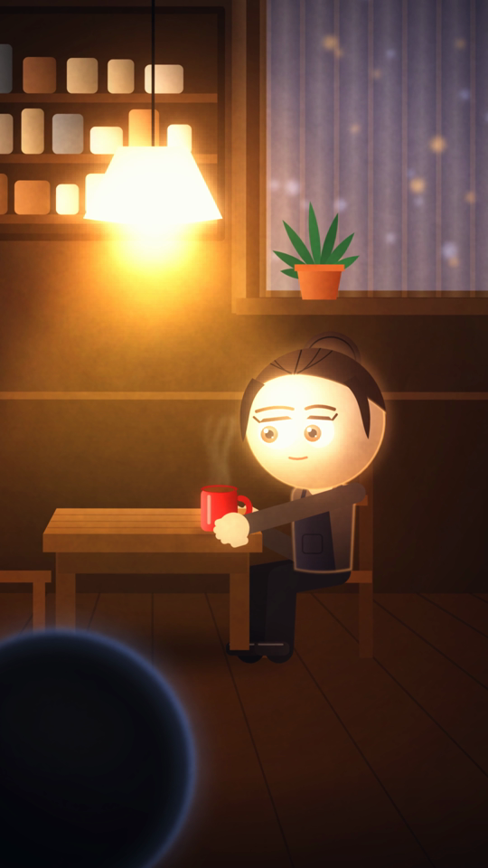

- **Локация:** Кухня (общий)
- **Персонажи:** Мама, Арман (спина)
- **План:** общий через плечо · **Камера:** из дверного проёма · **Движение:** медленный наезд
- **Действие:** Мама за столом, пар от кружки — будто ничего не было
- **Эмоции:** обманчивый уют
- **Диалог:** —
- **Звук:** звон кружки, тиканье
- **Свет:** тёплый янтарь
- **Переход:** склейка
- **Способ:** процедурная 2.5D-анимация (skia, риг scripts/engine/rig2.py, стандарт серии), нативные 60 fps · **Исходник:** `scripts/ep02_shots.py::s15`

## S16 · 00:49.00–00:53.40 (4.4 с) — КП мамы: «Сынок, садись. Чай остывает.» — красный проблеск в глазах

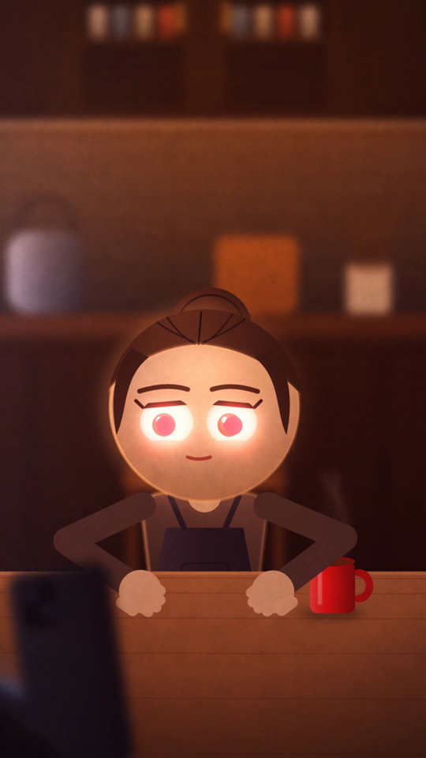

- **Локация:** Кухня (восток)
- **Персонажи:** Мама
- **План:** КП · **Камера:** через плечо Армана · **Движение:** медленный наезд
- **Действие:** «Сынок, садись. Чай остывает.» — красный проблеск в глазах (1 кадр-вспышка, плавный)
- **Эмоции:** тепло → жуть
- **Диалог:** mom: Сынок, садись. Чай остывает.
- **Звук:** тиканье, глитч
- **Свет:** тёплый, мигание лампы
- **Переход:** склейка
- **Способ:** процедурная 2.5D-анимация (skia, риг scripts/engine/rig2.py, стандарт серии), нативные 60 fps · **Исходник:** `scripts/ep02_shots.py::s16`

## S17 · 00:53.40–00:56.20 (2.8 с) — Инсерт: «ЭТО НЕ ОНА.»

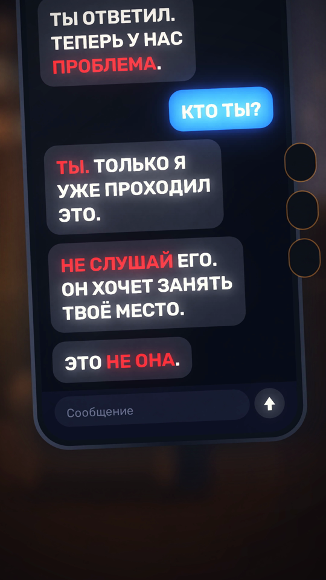

- **Локация:** Инсерт
- **Персонажи:** телефон
- **План:** деталь · **Камера:** сверху · **Движение:** микро-наезд, вибрация
- **Действие:** Новое сообщение: «ЭТО НЕ ОНА.»
- **Эмоции:** удар
- **Диалог:** —
- **Звук:** вибро, поп, сердцебиение
- **Свет:** экран, расфокус кухни
- **Переход:** склейка
- **Способ:** процедурная 2.5D-анимация (skia, риг scripts/engine/rig2.py, стандарт серии), нативные 60 fps · **Исходник:** `scripts/ep02_shots.py::s17`

## S18 · 00:56.20–00:58.60 (2.4 с) — ДКП Армана: взгляд с телефона на маму

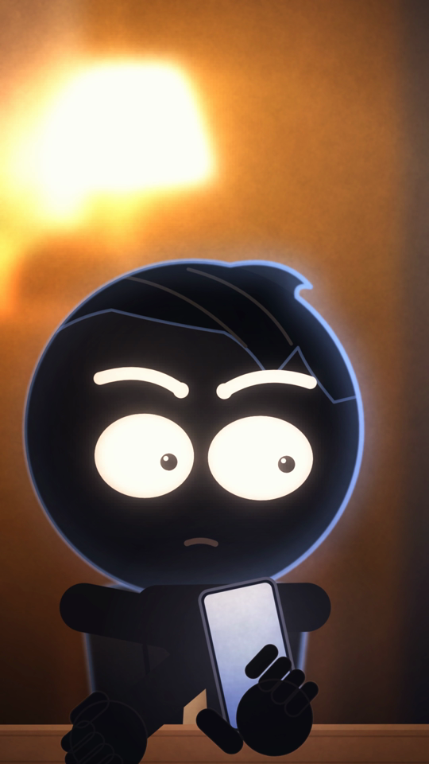

- **Локация:** Кухня (запад)
- **Персонажи:** Арман
- **План:** ДКП · **Камера:** фронтально · **Движение:** медленный наезд
- **Действие:** Взгляд с телефона на маму
- **Эмоции:** ужас
- **Диалог:** —
- **Звук:** сердцебиение, музыка обрывается
- **Свет:** свет телефона снизу, синий контур
- **Переход:** резкая склейка
- **Способ:** процедурная 2.5D-анимация (skia, риг scripts/engine/rig2.py, стандарт серии), нативные 60 fps · **Исходник:** `scripts/ep02_shots.py::s18`

## S19 · 00:58.60–00:58.90 (0.3 с) — Резкая склейка в чёрный

- **Локация:** —
- **Персонажи:** —
- **План:** чёрный · **Камера:** — · **Движение:** —
- **Действие:** Резкий обрыв
- **Эмоции:** —
- **Диалог:** —
- **Звук:** тишина
- **Свет:** —
- **Переход:** склейка
- **Способ:** процедурная 2.5D-анимация (skia, риг scripts/engine/rig2.py, стандарт серии), нативные 60 fps · **Исходник:** `scripts/ep02_shots.py::s19`

## S20 · 00:58.90–01:02.40 (3.5 с) — Титр «ТОГДА КТО ОНА?»

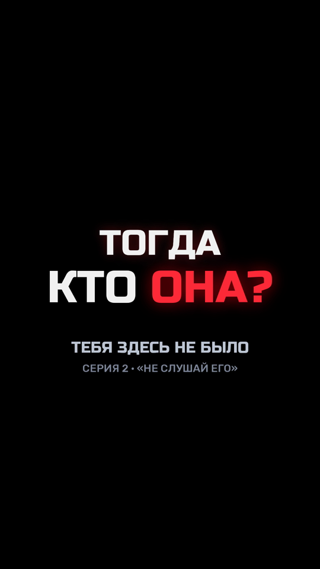

- **Локация:** Титр
- **Персонажи:** —
- **План:** титр · **Камера:** — · **Движение:** глитч-появление
- **Действие:** «ТОГДА КТО ОНА?» + название серии
- **Эмоции:** вопрос зрителю
- **Диалог:** —
- **Звук:** низкий удар + мотив
- **Свет:** —
- **Переход:** конец
- **Способ:** процедурная 2.5D-анимация (skia, риг scripts/engine/rig2.py, стандарт серии), нативные 60 fps · **Исходник:** `scripts/ep02_shots.py::s20`
