# Серия 03 «ДВЕРЬ 048» — раскадровка и shot list

Хронометраж: 61.60 с · 1080×1920 · 60 fps · 21 планов · кадры взяты из renders/ep03/ep03_picture_master.mp4

## S01 · 00:00.00–00:03.20 (3.2 с) — Кухня: КП мамы — слишком ровная улыбка, голова наклоняется чуть дальше нормы: «Сынок, ты чего? Садись.»

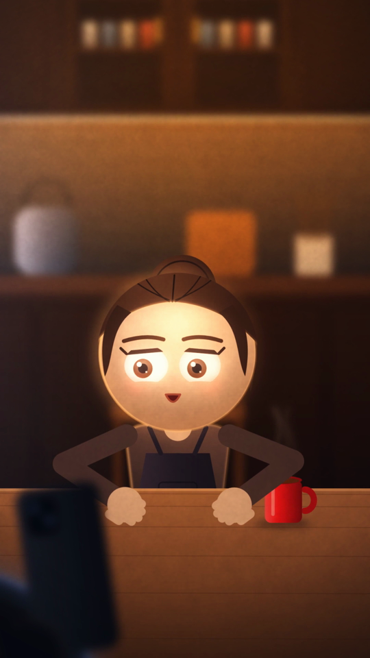

- **Локация:** Кухня (восток)
- **Персонажи:** Мама
- **План:** КП · **Камера:** через плечо Армана · **Движение:** медленный наезд
- **Действие:** Слишком ровная улыбка, голова наклоняется дальше нормы, перестаёт моргать
- **Эмоции:** жуткая теплота
- **Диалог:** mom: Сынок, ты чего? Садись.
- **Звук:** комнатный тон, часы
- **Свет:** тёплый янтарь
- **Переход:** из конца серии 2
- **Способ:** процедурная 2.5D-анимация (skia, риг scripts/engine/rig2.py, подъезд engine/sets3.py, стандарт серии), нативные 60 fps · **Исходник:** `scripts/ep03_shots.py::s01`

## S02 · 00:03.20–00:05.80 (2.6 с) — ДКП Армана: пятится, свет телефона снизу: «Где моя мама?»

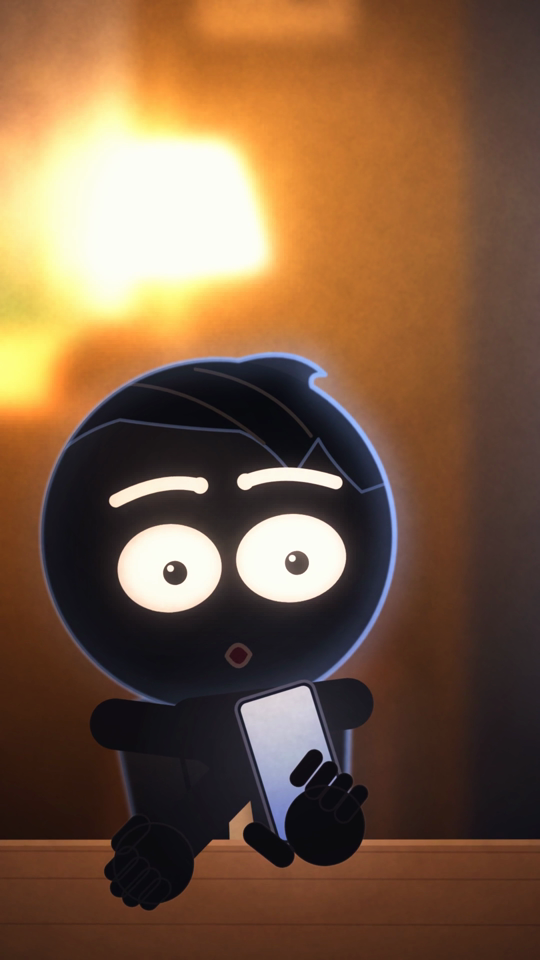

- **Локация:** Кухня (запад)
- **Персонажи:** Арман
- **План:** ДКП · **Камера:** фронтально · **Движение:** отъезд
- **Действие:** Пятится от стола, свет телефона снизу: «Где моя мама?»
- **Эмоции:** страх
- **Диалог:** arman: Где моя мама?
- **Звук:** тишина, дыхание
- **Свет:** тёплый + синий контур
- **Переход:** склейка
- **Способ:** процедурная 2.5D-анимация (skia, риг scripts/engine/rig2.py, подъезд engine/sets3.py, стандарт серии), нативные 60 fps · **Исходник:** `scripts/ep03_shots.py::s02`

## S03 · 00:05.80–00:09.40 (3.6 с) — КП мамы: «Я здесь. Я всегда здесь.» — лампа проседает, глаза медленно наливаются красным

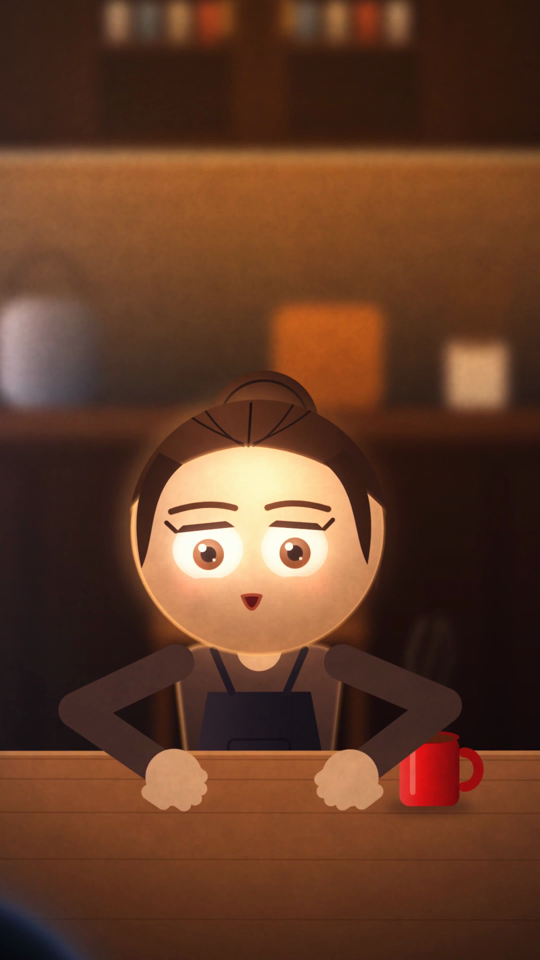

- **Локация:** Кухня (восток)
- **Персонажи:** Мама
- **План:** КП · **Камера:** через плечо Армана · **Движение:** наезд
- **Действие:** «Я здесь. Я всегда здесь.» — глаза плавно наливаются красным, лампа проседает
- **Эмоции:** угроза
- **Диалог:** mom: Я здесь. Я всегда здесь.
- **Звук:** кластер, гул
- **Свет:** тёплый → красный
- **Переход:** склейка
- **Способ:** процедурная 2.5D-анимация (skia, риг scripts/engine/rig2.py, подъезд engine/sets3.py, стандарт серии), нативные 60 fps · **Исходник:** `scripts/ep03_shots.py::s03`

## S04 · 00:09.40–00:11.60 (2.2 с) — Коридор: Арман бежит к входной двери, она распахивается в холодный свет

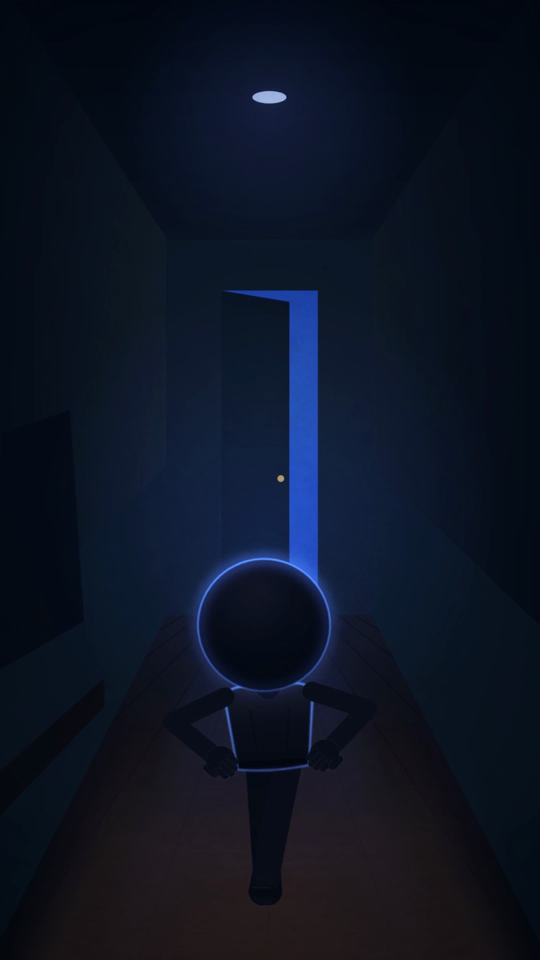

- **Локация:** Коридор
- **Персонажи:** Арман (со спины)
- **План:** общий · **Камера:** из кухни · **Движение:** наезд
- **Действие:** Бежит к входной двери, она распахивается в холодный свет
- **Эмоции:** паника
- **Диалог:** —
- **Звук:** скрип стула, шаги, пульс
- **Свет:** холодный из подъезда
- **Переход:** склейка
- **Способ:** процедурная 2.5D-анимация (skia, риг scripts/engine/rig2.py, подъезд engine/sets3.py, стандарт серии), нативные 60 fps · **Исходник:** `scripts/ep03_shots.py::s04`

## S05 · 00:11.60–00:14.60 (3.0 с) — Подъезд: дверь 048 захлопывается, Арман прижимается к ней спиной, тяжело дышит

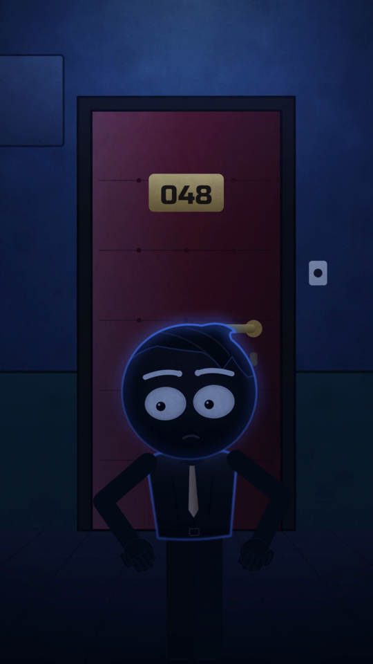

- **Локация:** Подъезд, дверь 048
- **Персонажи:** Арман
- **План:** средний · **Камера:** фронтально · **Движение:** удар камеры при хлопке
- **Действие:** Дверь захлопывается, Арман прижимается к ней спиной, тяжело дышит
- **Эмоции:** шок
- **Диалог:** —
- **Звук:** хлопок двери, дыхание
- **Свет:** холодный плафон
- **Переход:** склейка по звуку
- **Способ:** процедурная 2.5D-анимация (skia, риг scripts/engine/rig2.py, подъезд engine/sets3.py, стандарт серии), нативные 60 fps · **Исходник:** `scripts/ep03_shots.py::s05`

## S06 · 00:14.60–00:17.20 (2.6 с) — Инсерт: «НЕ ВОЗВРАЩАЙСЯ. СПУСКАЙСЯ ВНИЗ.»

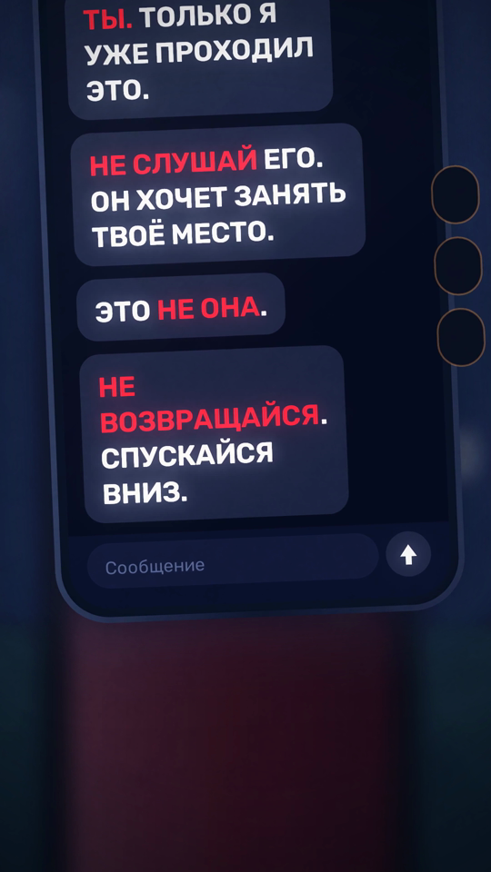

- **Локация:** Инсерт
- **Персонажи:** телефон
- **План:** деталь · **Камера:** сверху · **Движение:** микро-наезд
- **Действие:** Сообщение: «НЕ ВОЗВРАЩАЙСЯ. СПУСКАЙСЯ ВНИЗ.»
- **Эмоции:** приказ
- **Диалог:** —
- **Звук:** вибро, поп
- **Свет:** экран
- **Переход:** склейка
- **Способ:** процедурная 2.5D-анимация (skia, риг scripts/engine/rig2.py, подъезд engine/sets3.py, стандарт серии), нативные 60 fps · **Исходник:** `scripts/ep03_shots.py::s06`

## S07 · 00:17.20–00:19.40 (2.2 с) — Подъезд: Арман сбегает по лестнице вниз — и выходит на ту же площадку

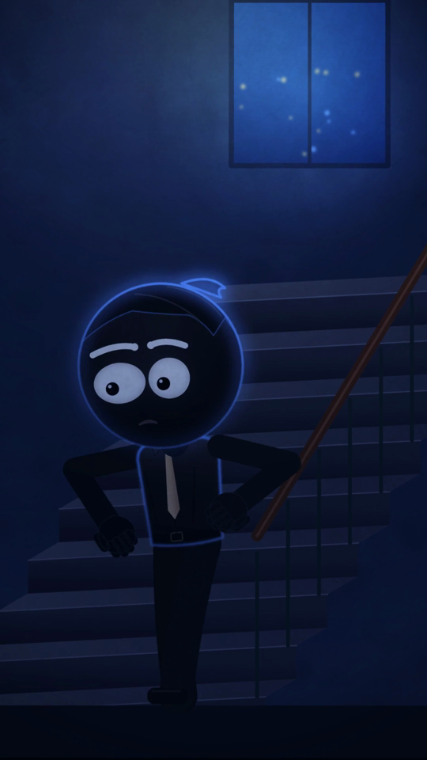

- **Локация:** Подъезд, лестница
- **Персонажи:** Арман
- **План:** общий · **Камера:** снизу марша · **Движение:** наезд
- **Действие:** Сбегает вниз по лестнице и уходит из кадра
- **Эмоции:** решимость
- **Диалог:** —
- **Звук:** шаги с эхом
- **Свет:** холодный, окно
- **Переход:** склейка по движению
- **Способ:** процедурная 2.5D-анимация (skia, риг scripts/engine/rig2.py, подъезд engine/sets3.py, стандарт серии), нативные 60 fps · **Исходник:** `scripts/ep03_shots.py::s07`

## S08 · 00:19.40–00:23.20 (3.8 с) — СП Армана перед той же дверью 048: «Так. Спокойно. Это просто… тот же этаж.»

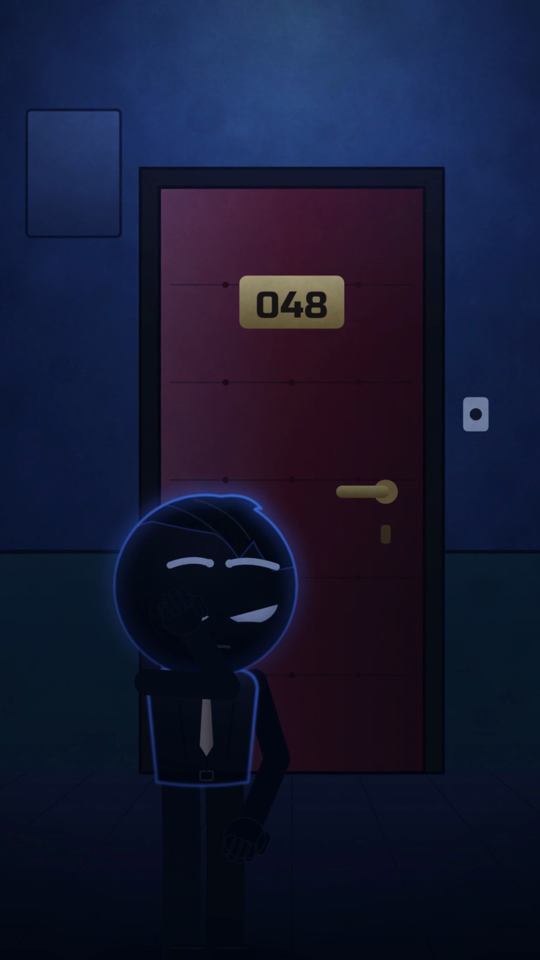

- **Локация:** Подъезд, дверь 048
- **Персонажи:** Арман
- **План:** средний · **Камера:** фронтально · **Движение:** наезд
- **Действие:** Выходит на площадку — та же дверь 048: «Так. Спокойно. Это просто… тот же этаж.»
- **Эмоции:** нервный смех
- **Диалог:** arman: Так. Спокойно. Это просто… тот же этаж.
- **Звук:** шаги, эхо
- **Свет:** холодный
- **Переход:** склейка
- **Способ:** процедурная 2.5D-анимация (skia, риг scripts/engine/rig2.py, подъезд engine/sets3.py, стандарт серии), нативные 60 fps · **Исходник:** `scripts/ep03_shots.py::s08`

## S09 · 00:23.20–00:25.80 (2.6 с) — Общий подъезда: номера на всех дверях один за другим становятся «048»

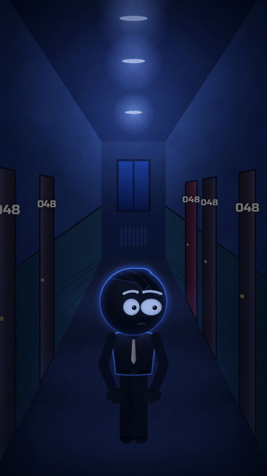

- **Локация:** Подъезд (общий)
- **Персонажи:** Арман
- **План:** общий · **Камера:** по оси коридора · **Движение:** медленный наезд
- **Действие:** Номера на всех дверях один за другим становятся «048»
- **Эмоции:** ужас
- **Диалог:** —
- **Звук:** глитч на каждой двери
- **Свет:** холодный
- **Переход:** склейка
- **Способ:** процедурная 2.5D-анимация (skia, риг scripts/engine/rig2.py, подъезд engine/sets3.py, стандарт серии), нативные 60 fps · **Исходник:** `scripts/ep03_shots.py::s09`

## S10 · 00:25.80–00:28.00 (2.2 с) — КП Армана; голос за кадром: «Ты тоже ходишь по кругу?» — резкий взгляд вверх

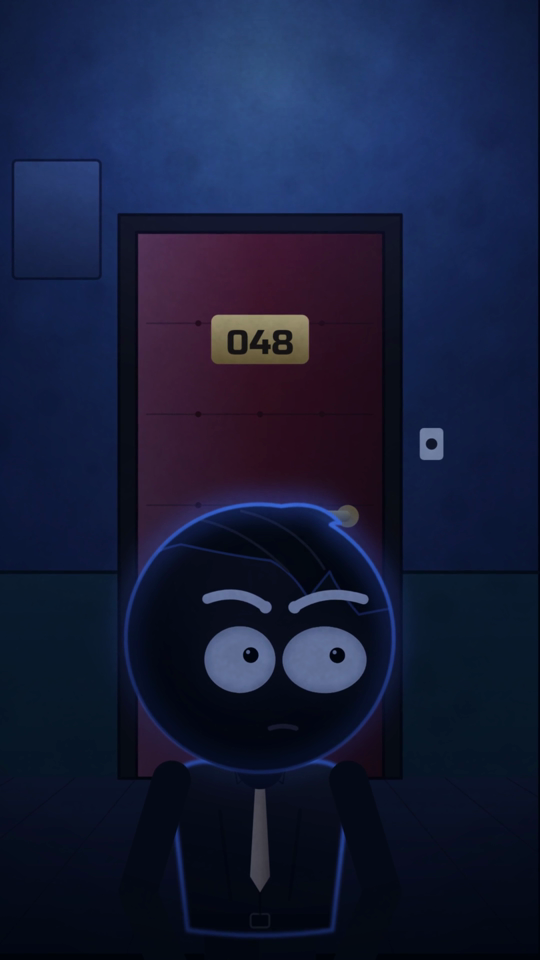

- **Локация:** Подъезд, дверь 048
- **Персонажи:** Арман
- **План:** КП · **Камера:** фронтально · **Движение:** статично
- **Действие:** Детский голос за кадром — взгляд резко вверх
- **Эмоции:** испуг
- **Диалог:** girl: Ты тоже ходишь по кругу?
- **Звук:** свуш
- **Свет:** холодный
- **Переход:** склейка по взгляду
- **Способ:** процедурная 2.5D-анимация (skia, риг scripts/engine/rig2.py, подъезд engine/sets3.py, стандарт серии), нативные 60 fps · **Исходник:** `scripts/ep03_shots.py::s10`

## S11 · 00:28.00–00:31.20 (3.2 с) — Девочка сидит на ступеньках выше; Арман: «Ты… ты кто такая?»

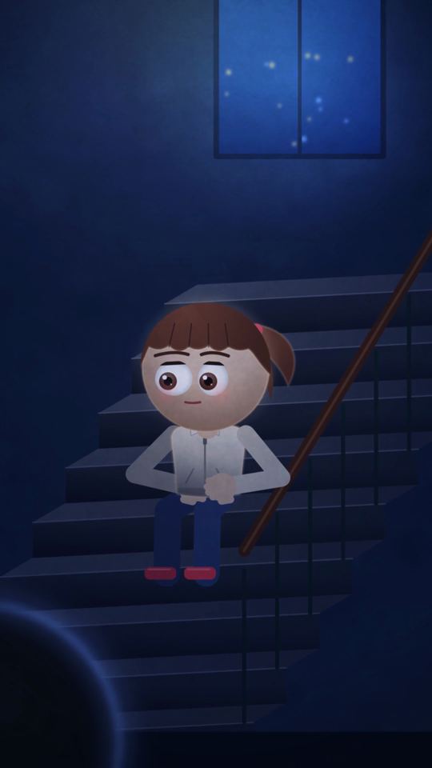

- **Локация:** Подъезд, лестница
- **Персонажи:** Девочка, Арман (спина)
- **План:** общий через плечо · **Камера:** с площадки · **Движение:** наезд
- **Действие:** Девочка сидит на ступеньках; «Ты… ты кто такая?»; наклоняет голову
- **Эмоции:** любопытство
- **Диалог:** arman: Ты… ты кто такая?
- **Звук:** шорох одежды, музыкальная шкатулка
- **Свет:** холодный + тёплый контур девочки
- **Переход:** склейка
- **Способ:** процедурная 2.5D-анимация (skia, риг scripts/engine/rig2.py, подъезд engine/sets3.py, стандарт серии), нативные 60 fps · **Исходник:** `scripts/ep03_shots.py::s11`

## S12 · 00:31.20–00:35.00 (3.8 с) — СП девочки: «Я тут давно. Здесь все двери — твои.»

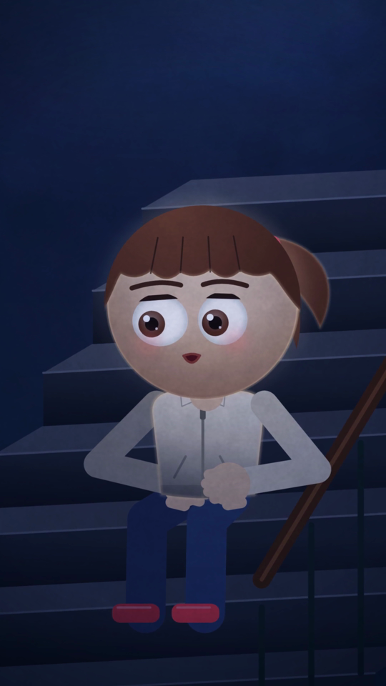

- **Локация:** Подъезд, лестница
- **Персонажи:** Девочка
- **План:** СП · **Камера:** снизу · **Движение:** медленный наезд
- **Действие:** «Я тут давно. Здесь все двери — твои.» — жест в сторону дверей
- **Эмоции:** спокойствие
- **Диалог:** girl: Я тут давно. Здесь все двери — твои.
- **Звук:** пианино
- **Свет:** холодный
- **Переход:** склейка
- **Способ:** процедурная 2.5D-анимация (skia, риг scripts/engine/rig2.py, подъезд engine/sets3.py, стандарт серии), нативные 60 fps · **Исходник:** `scripts/ep03_shots.py::s12`

## S13 · 00:35.00–00:39.60 (4.6 с) — КП девочки, неожиданно серьёзно: «Каждый раз ты убегаешь. И каждый раз возвращаешься.»

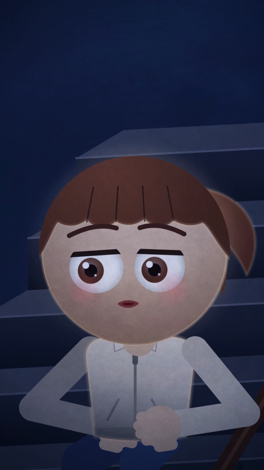

- **Локация:** Подъезд, лестница
- **Персонажи:** Девочка
- **План:** КП · **Камера:** фронтально · **Движение:** наезд
- **Действие:** Неожиданно серьёзно: «Каждый раз ты убегаешь из квартиры. И каждый раз возвращаешься.»
- **Эмоции:** серьёзность
- **Диалог:** girl: Каждый раз ты убегаешь из квартиры. И каждый раз возвращаешься.
- **Звук:** пианино, пэд
- **Свет:** холодный, свет чуть гаснет
- **Переход:** склейка
- **Способ:** процедурная 2.5D-анимация (skia, риг scripts/engine/rig2.py, подъезд engine/sets3.py, стандарт серии), нативные 60 fps · **Исходник:** `scripts/ep03_shots.py::s13`

## S14 · 00:39.60–00:42.00 (2.4 с) — Инсерт: ручка двери 048 медленно поворачивается, из щели — тёплый свет

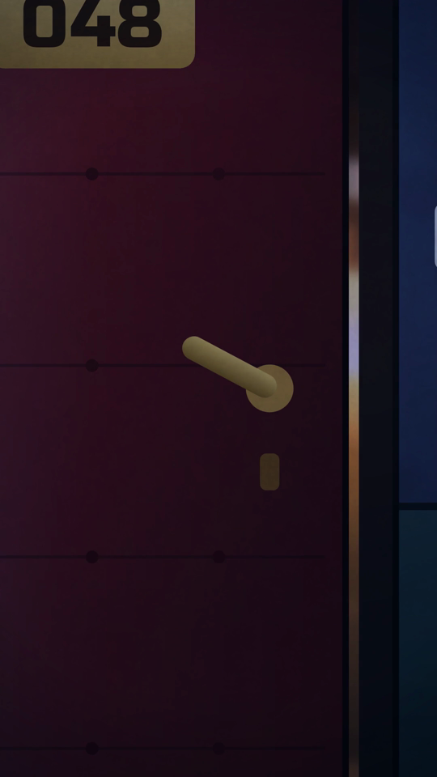

- **Локация:** Инсерт
- **Персонажи:** дверь 048
- **План:** деталь · **Камера:** у ручки · **Движение:** микро-наезд
- **Действие:** Ручка сама поворачивается, в щели — тёплый свет
- **Эмоции:** угроза
- **Диалог:** —
- **Звук:** скрип ручки, скрип двери
- **Свет:** холодный + тёплая щель
- **Переход:** склейка
- **Способ:** процедурная 2.5D-анимация (skia, риг scripts/engine/rig2.py, подъезд engine/sets3.py, стандарт серии), нативные 60 fps · **Исходник:** `scripts/ep03_shots.py::s14`

## S15 · 00:42.00–00:45.40 (3.4 с) — Арман оборачивается; дверь приоткрыта, из кухни голос мамы: «Сынок, садись. Чай остывает.»

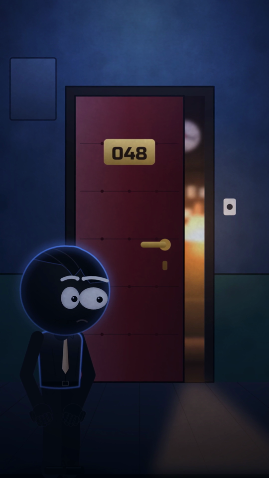

- **Локация:** Подъезд, дверь 048
- **Персонажи:** Арман
- **План:** средний · **Камера:** фронтально · **Движение:** наезд
- **Действие:** Арман оборачивается; дверь приоткрывается; голос мамы изнутри (тот же, что в серии 2)
- **Эмоции:** оцепенение
- **Диалог:** mom: Сынок, садись. Чай остывает.
- **Звук:** приглушённый голос, тиканье за дверью
- **Свет:** тёплый из щели
- **Переход:** склейка
- **Способ:** процедурная 2.5D-анимация (skia, риг scripts/engine/rig2.py, подъезд engine/sets3.py, стандарт серии), нативные 60 fps · **Исходник:** `scripts/ep03_shots.py::s15`

## S16 · 00:45.40–00:48.40 (3.0 с) — Девочка хватает Армана за рукав, шёпотом: «Не заходи. Там уже есть ты.»

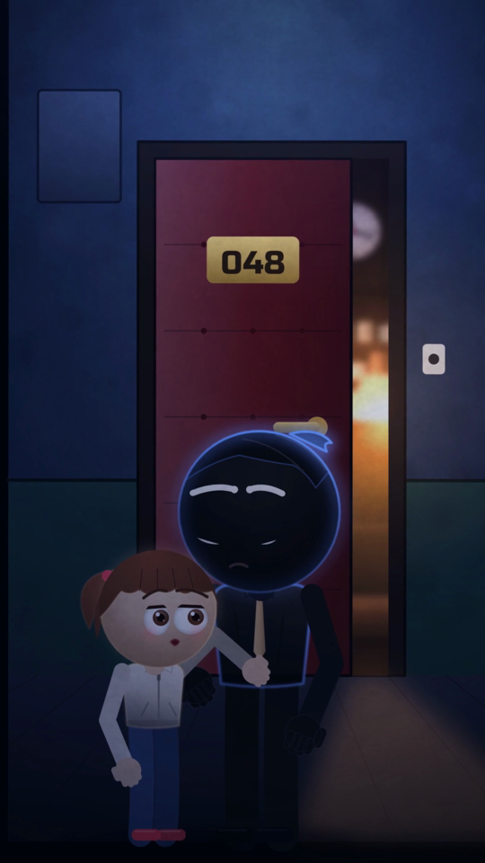

- **Локация:** Подъезд, дверь 048
- **Персонажи:** Девочка, Арман
- **План:** средний двухшотовый · **Камера:** фронтально · **Движение:** наезд
- **Действие:** Девочка хватает его за рукав: «Не заходи. Там уже есть ты.»
- **Эмоции:** тревога
- **Диалог:** girl: Не заходи. Там уже есть ты.
- **Звук:** шорох, сердцебиение
- **Свет:** холодный + тёплый
- **Переход:** склейка
- **Способ:** процедурная 2.5D-анимация (skia, риг scripts/engine/rig2.py, подъезд engine/sets3.py, стандарт серии), нативные 60 fps · **Исходник:** `scripts/ep03_shots.py::s16`

## S17 · 00:48.40–00:51.40 (3.0 с) — Сквозь щель: за кухонным столом рядом с мамой сидит двойник — медленно поворачивается к двери

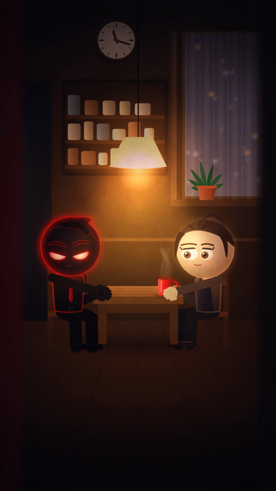

- **Локация:** Кухня сквозь щель
- **Персонажи:** Двойник, Мама
- **План:** общий через щель · **Камера:** из подъезда · **Движение:** наезд
- **Действие:** За столом рядом с мамой сидит двойник — медленно поворачивается к двери
- **Эмоции:** жуть
- **Диалог:** —
- **Звук:** реверс + низкий удар
- **Свет:** тёплый янтарь, красный контур
- **Переход:** склейка
- **Способ:** процедурная 2.5D-анимация (skia, риг scripts/engine/rig2.py, подъезд engine/sets3.py, стандарт серии), нативные 60 fps · **Исходник:** `scripts/ep03_shots.py::s17`

## S18 · 00:51.40–00:55.20 (3.8 с) — Инсерт: экран телефона захвачен системой: «ОБЪЕКТ 048 · ВНЕ ЗОНЫ · ПЕРЕЗАПУСК»

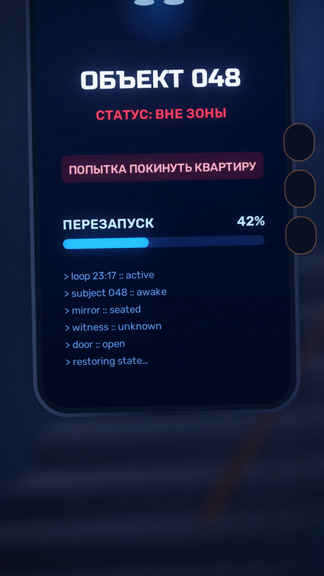

- **Локация:** Инсерт
- **Персонажи:** телефон
- **План:** деталь · **Камера:** сверху · **Движение:** микро-наезд
- **Действие:** Экран захвачен системой: «ОБЪЕКТ 048 · ВНЕ ЗОНЫ · ПЕРЕЗАПУСК»; голос оператора
- **Эмоции:** холод системы
- **Диалог:** operator: Объект 048 вне зоны. Начинаю перезапуск.
- **Звук:** глитч, сигналы
- **Свет:** синий экран
- **Переход:** наплыв на экране
- **Способ:** процедурная 2.5D-анимация (skia, риг scripts/engine/rig2.py, подъезд engine/sets3.py, стандарт серии), нативные 60 fps · **Исходник:** `scripts/ep03_shots.py::s18`

## S19 · 00:55.20–00:57.80 (2.6 с) — Общий подъезда: лампы гаснут одна за другой от дальней к ближней

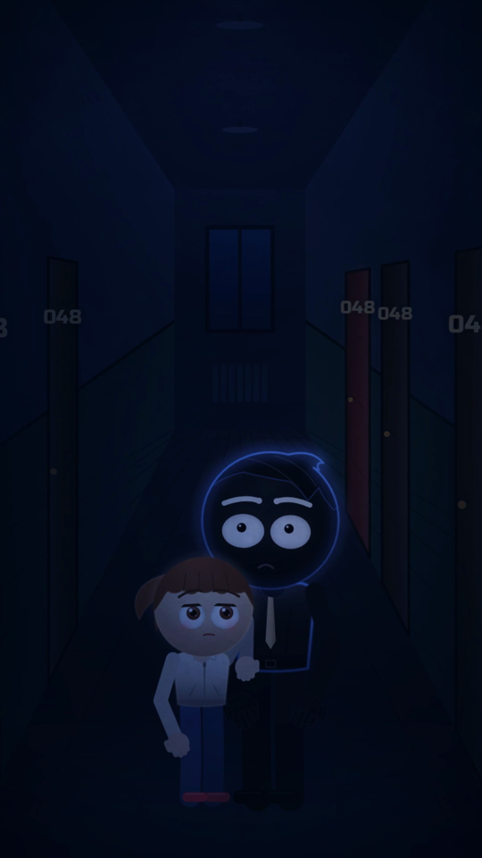

- **Локация:** Подъезд (общий)
- **Персонажи:** Арман, Девочка
- **План:** общий · **Камера:** по оси коридора · **Движение:** наезд
- **Действие:** Плафоны гаснут один за другим от дальнего к ближнему (плавно, ≤2/с)
- **Эмоции:** ужас
- **Диалог:** —
- **Звук:** щелчки реле
- **Свет:** гаснет
- **Переход:** резкая склейка
- **Способ:** процедурная 2.5D-анимация (skia, риг scripts/engine/rig2.py, подъезд engine/sets3.py, стандарт серии), нативные 60 fps · **Исходник:** `scripts/ep03_shots.py::s19`

## S20 · 00:57.80–00:58.10 (0.3 с) — Чёрный

- **Локация:** —
- **Персонажи:** —
- **План:** чёрный · **Камера:** — · **Движение:** —
- **Действие:** Обрыв
- **Эмоции:** —
- **Диалог:** —
- **Звук:** тишина
- **Свет:** —
- **Переход:** склейка
- **Способ:** процедурная 2.5D-анимация (skia, риг scripts/engine/rig2.py, подъезд engine/sets3.py, стандарт серии), нативные 60 fps · **Исходник:** `scripts/ep03_shots.py::s20`

## S21 · 00:58.10–01:01.60 (3.5 с) — Титр «СКОЛЬКО РАЗ ТЫ УЖЕ ЭТО ВИДЕЛ?»

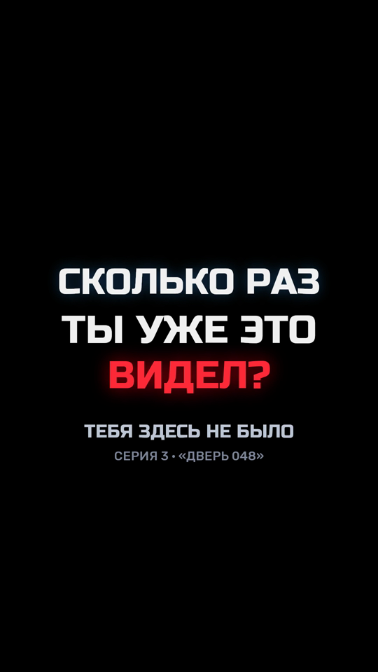

- **Локация:** Титр
- **Персонажи:** —
- **План:** титр · **Камера:** — · **Движение:** глитч-появление
- **Действие:** «СКОЛЬКО РАЗ ТЫ УЖЕ ЭТО ВИДЕЛ?» + название серии
- **Эмоции:** вопрос зрителю
- **Диалог:** —
- **Звук:** пианино + мотив
- **Свет:** —
- **Переход:** конец
- **Способ:** процедурная 2.5D-анимация (skia, риг scripts/engine/rig2.py, подъезд engine/sets3.py, стандарт серии), нативные 60 fps · **Исходник:** `scripts/ep03_shots.py::s21`
