# Серия 04 «КАК ОБЫЧНО?» — раскадровка и shot list

Хронометраж: 61.40 с · 1080×1920 · 60 fps · 20 планов · кадры взяты из renders/ep04/ep04_picture_master.mp4

## S01 · 00:00.00–00:03.00 (3.0 с) — Чёрный → резкий вдох: Арман просыпается за столиком кафе у окна; дождь, неон; часы 23:17

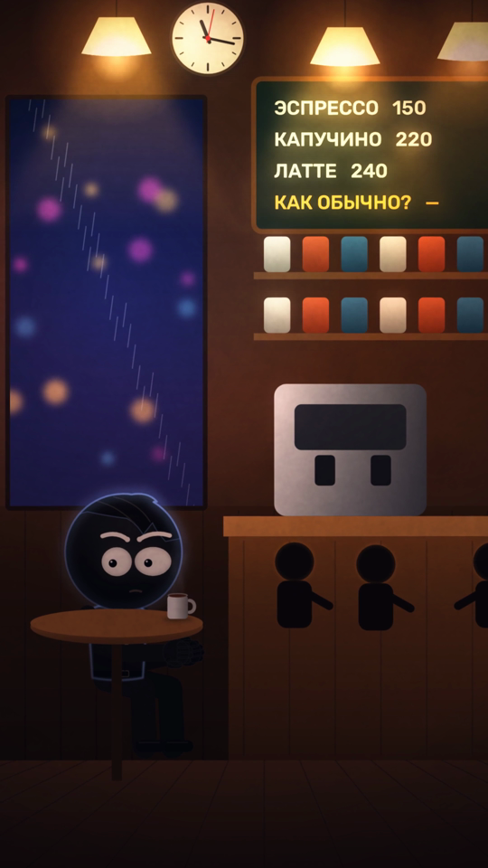

- **Локация:** Кафе (общий)
- **Персонажи:** Арман
- **План:** общий · **Камера:** от стойки · **Движение:** наезд
- **Действие:** Резкий вдох: Арман просыпается за столиком у окна; часы 23:17
- **Эмоции:** растерянность
- **Диалог:** —
- **Звук:** вдох, дождь за стеклом, гул кафе
- **Свет:** тёплые лампы, неон в окне
- **Переход:** из чёрного (после «ПЕРЕЗАПУСКА»)
- **Способ:** процедурная 2.5D-анимация (skia, риг scripts/engine/rig2.py, кафе, улица, комната наблюдения engine/sets4.py, стандарт серии), нативные 60 fps · **Исходник:** `scripts/ep04_shots.py::s01`

## S02 · 00:03.00–00:05.60 (2.6 с) — КП Армана: озирается, не понимает, где он

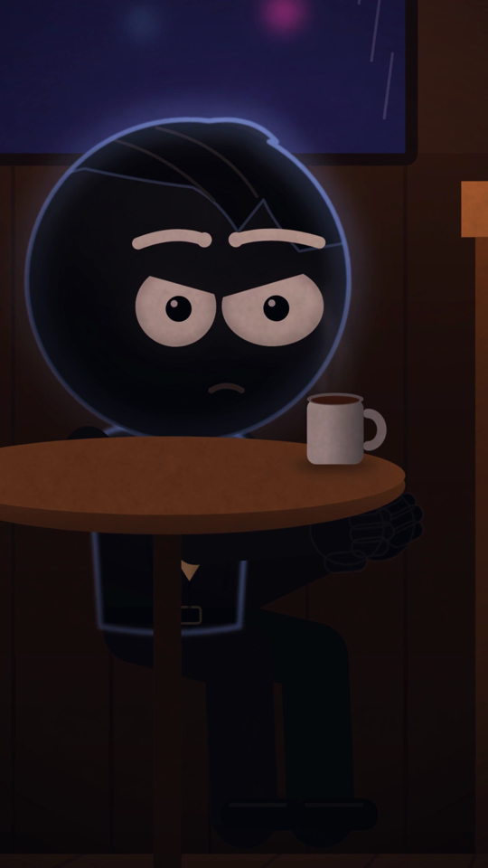

- **Локация:** Кафе
- **Персонажи:** Арман
- **План:** КП · **Камера:** фронтально · **Движение:** наезд
- **Действие:** Озирается
- **Эмоции:** тревога
- **Диалог:** —
- **Звук:** гул кафе
- **Свет:** тёплый + синий контур
- **Переход:** склейка
- **Способ:** процедурная 2.5D-анимация (skia, риг scripts/engine/rig2.py, кафе, улица, комната наблюдения engine/sets4.py, стандарт серии), нативные 60 fps · **Исходник:** `scripts/ep04_shots.py::s02`

## S03 · 00:05.60–00:09.60 (4.0 с) — Бариста ставит чашку: «Как обычно? Двойной, без сахара.»

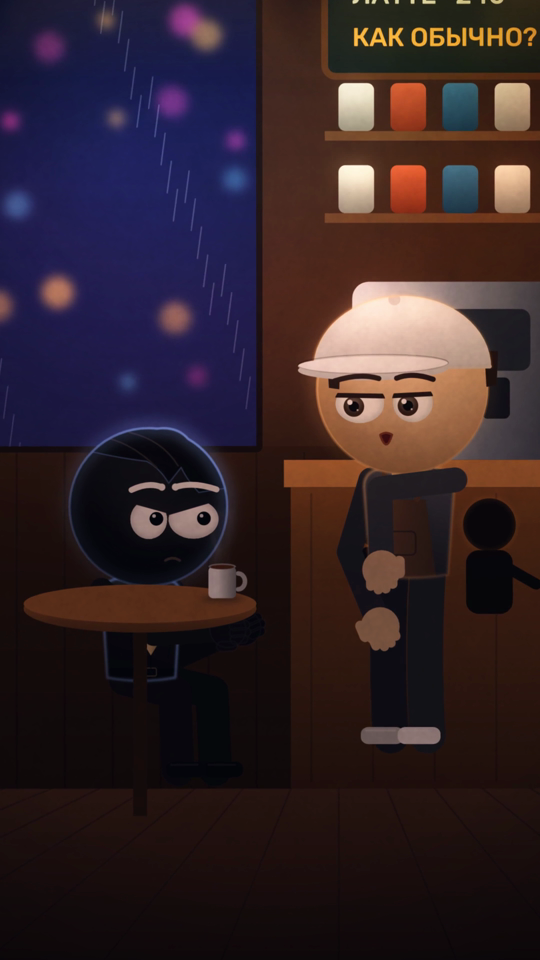

- **Локация:** Кафе
- **Персонажи:** Арман, Бариста
- **План:** средний двухшотовый · **Камера:** сбоку · **Движение:** наезд
- **Действие:** Бариста подходит и ставит чашку: «Как обычно? Двойной, без сахара.»
- **Эмоции:** обыденность
- **Диалог:** barista: Как обычно? Двойной, без сахара.
- **Звук:** шаги, звон чашки
- **Свет:** тёплый
- **Переход:** склейка
- **Способ:** процедурная 2.5D-анимация (skia, риг scripts/engine/rig2.py, кафе, улица, комната наблюдения engine/sets4.py, стандарт серии), нативные 60 fps · **Исходник:** `scripts/ep04_shots.py::s03`

## S04 · 00:09.60–00:12.40 (2.8 с) — КП Армана: «Я… давно здесь сижу?»

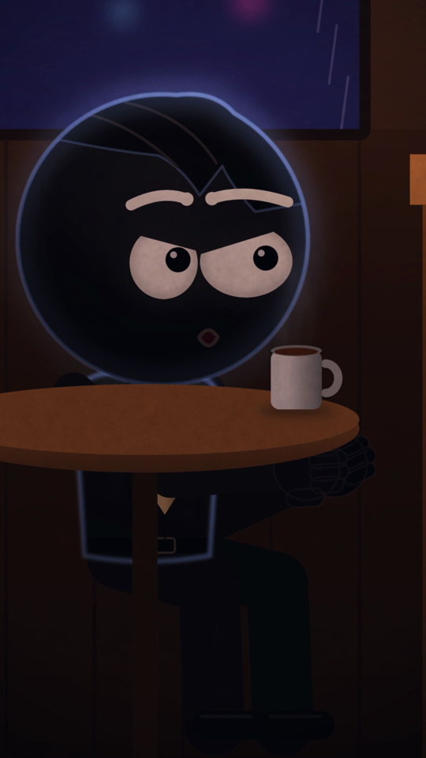

- **Локация:** Кафе
- **Персонажи:** Арман
- **План:** КП · **Камера:** фронтально · **Движение:** наезд
- **Действие:** «Я… давно здесь сижу?»
- **Эмоции:** недоумение
- **Диалог:** arman: Я… давно здесь сижу?
- **Звук:** гул кафе
- **Свет:** тёплый
- **Переход:** склейка
- **Способ:** процедурная 2.5D-анимация (skia, риг scripts/engine/rig2.py, кафе, улица, комната наблюдения engine/sets4.py, стандарт серии), нативные 60 fps · **Исходник:** `scripts/ep04_shots.py::s04`

## S05 · 00:12.40–00:16.40 (4.0 с) — СКП баристы: «Каждый вечер. Ровно в одиннадцать семнадцать.» — улыбка держится слишком долго

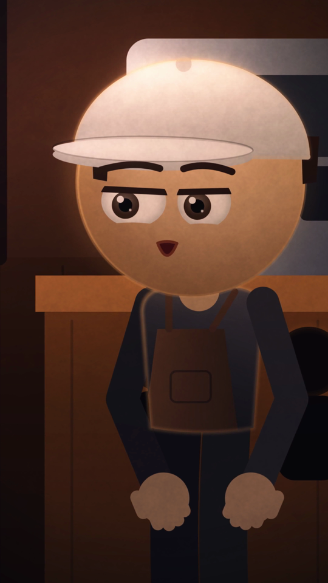

- **Локация:** Кафе
- **Персонажи:** Бариста
- **План:** КП · **Камера:** фронтально · **Движение:** наезд
- **Действие:** «Каждый вечер. Ровно в одиннадцать семнадцать.» — улыбка держится слишком долго
- **Эмоции:** ирония → жуть
- **Диалог:** barista: Каждый вечер. Ровно в 23:17.
- **Звук:** пэд
- **Свет:** тёплый
- **Переход:** склейка
- **Способ:** процедурная 2.5D-анимация (skia, риг scripts/engine/rig2.py, кафе, улица, комната наблюдения engine/sets4.py, стандарт серии), нативные 60 fps · **Исходник:** `scripts/ep04_shots.py::s05`

## S06 · 00:16.40–00:19.00 (2.6 с) — Инсерт: чат пуст («Сообщений нет») → новое: «ТЫ ПОМНИШЬ?»

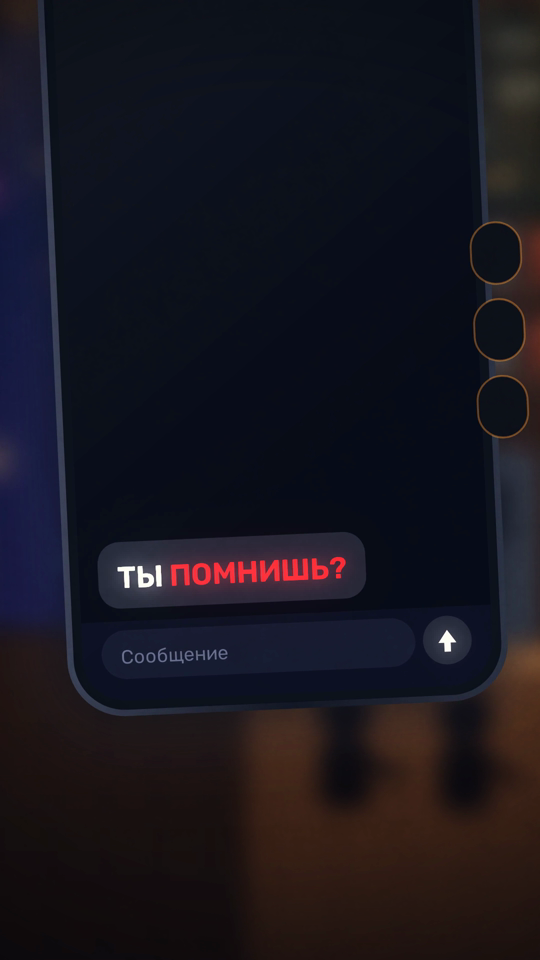

- **Локация:** Инсерт
- **Персонажи:** телефон
- **План:** деталь · **Камера:** сверху · **Движение:** микро-наезд
- **Действие:** Чат пуст («история очищена») → «ТЫ ПОМНИШЬ?»
- **Эмоции:** память
- **Диалог:** —
- **Звук:** вибро, поп, шкатулка
- **Свет:** экран
- **Переход:** склейка
- **Способ:** процедурная 2.5D-анимация (skia, риг scripts/engine/rig2.py, кафе, улица, комната наблюдения engine/sets4.py, стандарт серии), нативные 60 fps · **Исходник:** `scripts/ep04_shots.py::s06`

## S07 · 00:19.00–00:21.60 (2.6 с) — Инсерт: Арман печатает «ПОМНЮ.» и отправляет

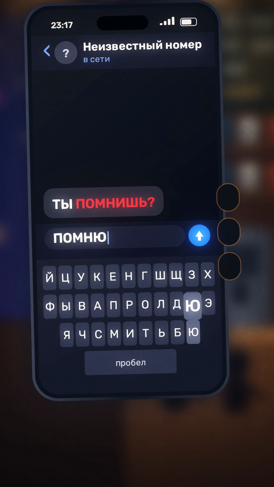

- **Локация:** Инсерт
- **Персонажи:** телефон
- **План:** деталь клавиатуры · **Камера:** сверху · **Движение:** статично
- **Действие:** Печатает «ПОМНЮ.» и отправляет
- **Эмоции:** решимость
- **Диалог:** —
- **Звук:** тапы, свуш
- **Свет:** экран
- **Переход:** склейка
- **Способ:** процедурная 2.5D-анимация (skia, риг scripts/engine/rig2.py, кафе, улица, комната наблюдения engine/sets4.py, стандарт серии), нативные 60 fps · **Исходник:** `scripts/ep04_shots.py::s07`

## S08 · 00:21.60–00:25.60 (4.0 с) — Комната наблюдения: стена мониторов, на одном — Арман в кафе; «ПАМЯТЬ СОХРАНЕНА»

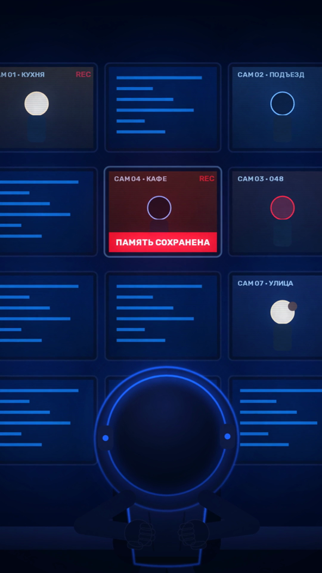

- **Локация:** Комната наблюдения
- **Персонажи:** Оператор (спина)
- **План:** общий · **Камера:** из-за спины оператора · **Движение:** наезд на монитор
- **Действие:** CAM 04 · КАФЕ: «ПАМЯТЬ СОХРАНЕНА»; «Объект 048. Память сохранена.»
- **Эмоции:** тревога системы
- **Диалог:** operator: Объект 048. Память сохранена.
- **Звук:** гул техники, сигналы
- **Свет:** синий + красный
- **Переход:** склейка
- **Способ:** процедурная 2.5D-анимация (skia, риг scripts/engine/rig2.py, кафе, улица, комната наблюдения engine/sets4.py, стандарт серии), нативные 60 fps · **Исходник:** `scripts/ep04_shots.py::s08`

## S09 · 00:25.60–00:28.60 (3.0 с) — КП оператора: «Удалите кафе.»

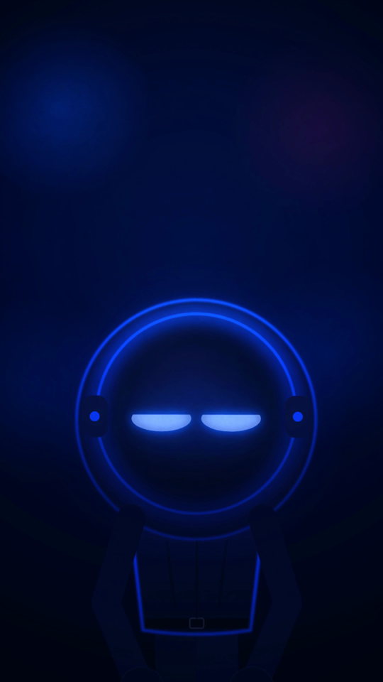

- **Локация:** Комната наблюдения
- **Персонажи:** Оператор
- **План:** КП · **Камера:** фронтально · **Движение:** наезд
- **Действие:** «Удалите кафе. Немедленно.» — веки сужаются
- **Эмоции:** холод
- **Диалог:** operator: Удалите кафе. Немедленно.
- **Звук:** реверс
- **Свет:** синие экраны
- **Переход:** склейка
- **Способ:** процедурная 2.5D-анимация (skia, риг scripts/engine/rig2.py, кафе, улица, комната наблюдения engine/sets4.py, стандарт серии), нативные 60 fps · **Исходник:** `scripts/ep04_shots.py::s09`

## S10 · 00:28.60–00:31.60 (3.0 с) — Кафе стирается: посетители исчезают, окно белеет, бариста замирает

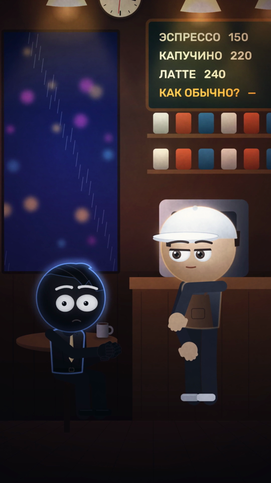

- **Локация:** Кафе (общий)
- **Персонажи:** Арман, Бариста
- **План:** общий · **Камера:** от стойки · **Движение:** наезд
- **Действие:** Кафе стирается: посетители исчезают, окно белеет, бариста замирает
- **Эмоции:** ужас
- **Диалог:** —
- **Звук:** цифровое растворение, глитчи, пульс
- **Свет:** тёплый → белая сетка
- **Переход:** склейка
- **Способ:** процедурная 2.5D-анимация (skia, риг scripts/engine/rig2.py, кафе, улица, комната наблюдения engine/sets4.py, стандарт серии), нативные 60 fps · **Исходник:** `scripts/ep04_shots.py::s10`

## S11 · 00:31.60–00:35.00 (3.4 с) — КП баристы, тихо: «Тебе лучше уйти. Прямо сейчас.»

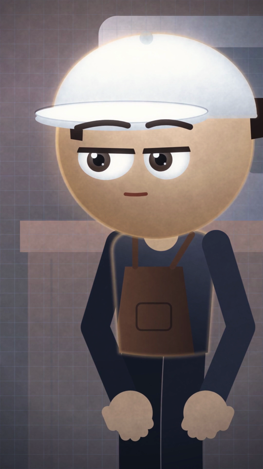

- **Локация:** Кафе
- **Персонажи:** Бариста
- **План:** КП · **Камера:** фронтально · **Движение:** наезд
- **Действие:** Тихо: «Тебе лучше уйти. Прямо сейчас.»
- **Эмоции:** предупреждение
- **Диалог:** barista: Тебе лучше уйти. Прямо сейчас.
- **Звук:** растворение
- **Свет:** белая сетка за спиной
- **Переход:** склейка
- **Способ:** процедурная 2.5D-анимация (skia, риг scripts/engine/rig2.py, кафе, улица, комната наблюдения engine/sets4.py, стандарт серии), нативные 60 fps · **Исходник:** `scripts/ep04_shots.py::s11`

## S12 · 00:35.00–00:37.40 (2.4 с) — Арман вскакивает и бежит к двери

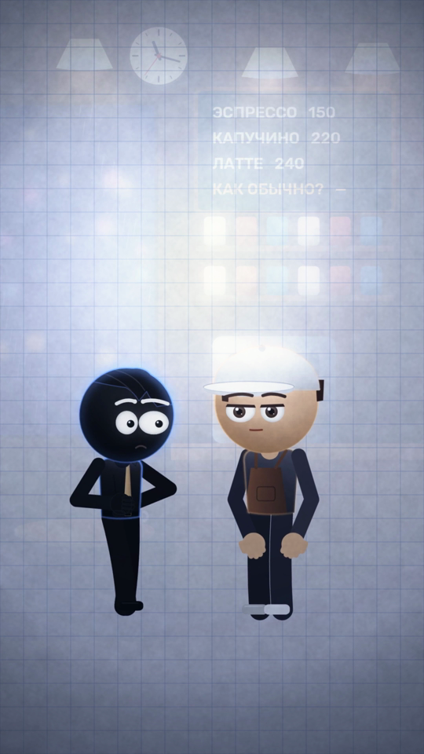

- **Локация:** Кафе (общий)
- **Персонажи:** Арман, Бариста
- **План:** общий · **Камера:** от стойки · **Движение:** панорама
- **Действие:** Арман вскакивает и бежит к двери
- **Эмоции:** паника
- **Диалог:** —
- **Звук:** скрип стула, шаги, колокольчик
- **Свет:** белое
- **Переход:** склейка по движению
- **Способ:** процедурная 2.5D-анимация (skia, риг scripts/engine/rig2.py, кафе, улица, комната наблюдения engine/sets4.py, стандарт серии), нативные 60 fps · **Исходник:** `scripts/ep04_shots.py::s12`

## S13 · 00:37.40–00:40.60 (3.2 с) — Улица: девочка под фонарём хватает его за руку: «Бежим! Пока они не стёрли улицу.»

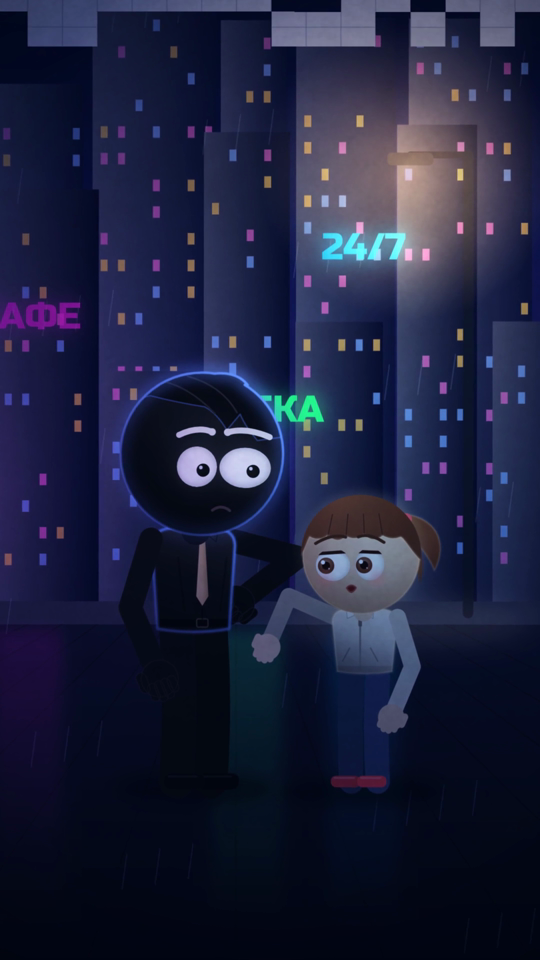

- **Локация:** Улица
- **Персонажи:** Арман, Девочка
- **План:** средний · **Камера:** с тротуара · **Движение:** наезд
- **Действие:** Девочка под фонарём хватает его за руку: «Бежим! Пока они не стёрли улицу.»
- **Эмоции:** срочность
- **Диалог:** girl: Бежим! Пока они не стёрли улицу.
- **Звук:** дождь, город, шорох
- **Свет:** неон + фонарь
- **Переход:** склейка
- **Способ:** процедурная 2.5D-анимация (skia, риг scripts/engine/rig2.py, кафе, улица, комната наблюдения engine/sets4.py, стандарт серии), нативные 60 fps · **Исходник:** `scripts/ep04_shots.py::s13`

## S14 · 00:40.60–00:44.00 (3.4 с) — Общий улицы: они бегут, за спиной дома рассыпаются в белую сетку

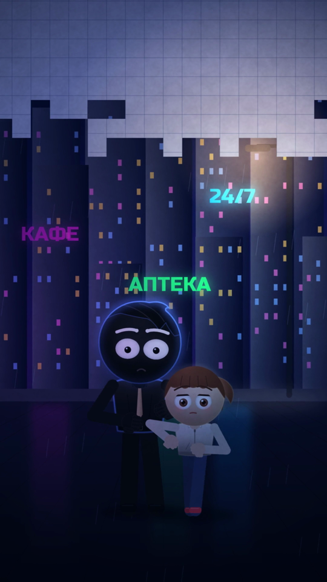

- **Локация:** Улица (общий)
- **Персонажи:** Арман, Девочка
- **План:** общий · **Камера:** навстречу · **Движение:** наезд
- **Действие:** Бегут к камере; за спиной дома рассыпаются в белую сетку
- **Эмоции:** бегство
- **Диалог:** —
- **Звук:** шаги, пульс
- **Свет:** неон
- **Переход:** склейка
- **Способ:** процедурная 2.5D-анимация (skia, риг scripts/engine/rig2.py, кафе, улица, комната наблюдения engine/sets4.py, стандарт серии), нативные 60 fps · **Исходник:** `scripts/ep04_shots.py::s14`

## S15 · 00:44.00–00:47.00 (3.0 с) — КП Армана на бегу: «Кто «они»? Кто ты вообще такая?»

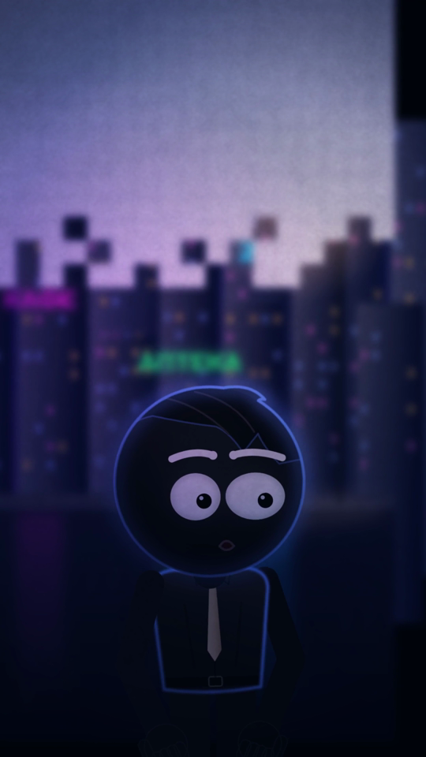

- **Локация:** Улица
- **Персонажи:** Арман
- **План:** КП на бегу · **Камера:** сбоку · **Движение:** трекинг
- **Действие:** «Кто «они»? Кто ты вообще такая?»
- **Эмоции:** паника
- **Диалог:** arman: Кто «они»? Кто ты вообще такая?
- **Звук:** шаги, дождь
- **Свет:** неон
- **Переход:** склейка
- **Способ:** процедурная 2.5D-анимация (skia, риг scripts/engine/rig2.py, кафе, улица, комната наблюдения engine/sets4.py, стандарт серии), нативные 60 fps · **Исходник:** `scripts/ep04_shots.py::s15`

## S16 · 00:47.00–00:51.00 (4.0 с) — КП девочки под фонарём: «Я — свидетель. Я помню все твои круги.»

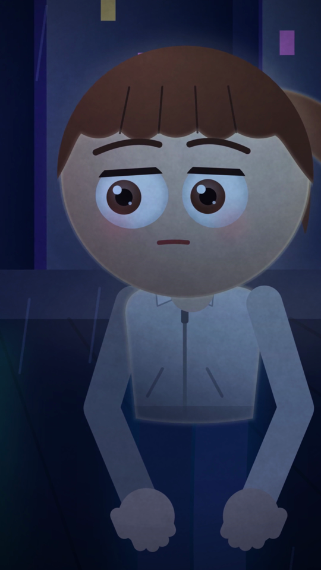

- **Локация:** Улица
- **Персонажи:** Девочка
- **План:** КП · **Камера:** фронтально · **Движение:** наезд
- **Действие:** «Я — свидетель. Я помню все твои круги.»
- **Эмоции:** серьёзность
- **Диалог:** girl: Я — свидетель. Я помню все твои круги.
- **Звук:** шкатулка (тихо), дождь
- **Свет:** тёплый фонарь
- **Переход:** склейка
- **Способ:** процедурная 2.5D-анимация (skia, риг scripts/engine/rig2.py, кафе, улица, комната наблюдения engine/sets4.py, стандарт серии), нативные 60 fps · **Исходник:** `scripts/ep04_shots.py::s16`

## S17 · 00:51.00–00:54.00 (3.0 с) — Комната наблюдения: на мониторе девочка — «СВИДЕТЕЛЬ ОБНАРУЖЕН»: «Свидетель найден. Начинаю сбор.»

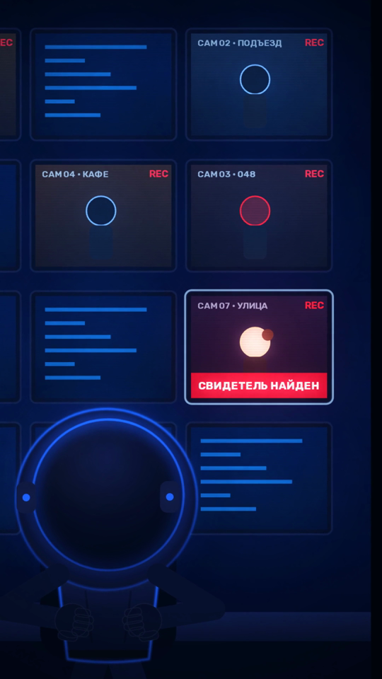

- **Локация:** Комната наблюдения
- **Персонажи:** Оператор (спина)
- **План:** средний · **Камера:** из-за спины · **Движение:** наезд
- **Действие:** CAM 07 · УЛИЦА: «СВИДЕТЕЛЬ НАЙДЕН»; «Свидетель найден. Начинаю сбор.»
- **Эмоции:** угроза
- **Диалог:** operator: Свидетель найден. Начинаю сбор.
- **Звук:** удар, сигналы
- **Свет:** синий + красный
- **Переход:** склейка
- **Способ:** процедурная 2.5D-анимация (skia, риг scripts/engine/rig2.py, кафе, улица, комната наблюдения engine/sets4.py, стандарт серии), нативные 60 fps · **Исходник:** `scripts/ep04_shots.py::s17`

## S18 · 00:54.00–00:57.40 (3.4 с) — Улица: белая пустота доходит до них; Арман тянет девочку — всё уходит в белое и гаснет

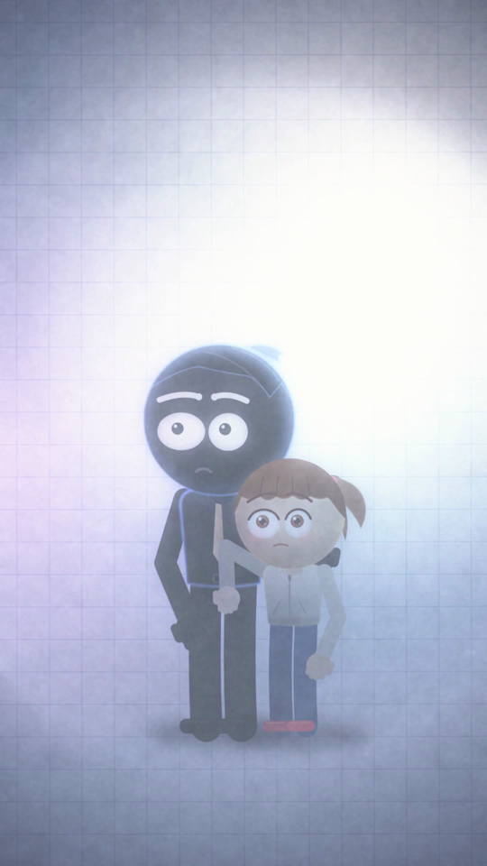

- **Локация:** Улица
- **Персонажи:** Арман, Девочка
- **План:** средний · **Камера:** с тротуара · **Движение:** наезд
- **Действие:** Белая пустота доходит до них; Арман прижимает девочку; всё уходит в белое и гаснет (плавно)
- **Эмоции:** отчаяние
- **Диалог:** —
- **Звук:** нарастающее растворение, удар
- **Свет:** белое → тьма
- **Переход:** затемнение
- **Способ:** процедурная 2.5D-анимация (skia, риг scripts/engine/rig2.py, кафе, улица, комната наблюдения engine/sets4.py, стандарт серии), нативные 60 fps · **Исходник:** `scripts/ep04_shots.py::s18`

## S19 · 00:57.40–00:57.70 (0.3 с) — Чёрный

- **Локация:** —
- **Персонажи:** —
- **План:** чёрный · **Камера:** — · **Движение:** —
- **Действие:** Тишина
- **Эмоции:** —
- **Диалог:** —
- **Звук:** тишина
- **Свет:** —
- **Переход:** склейка
- **Способ:** процедурная 2.5D-анимация (skia, риг scripts/engine/rig2.py, кафе, улица, комната наблюдения engine/sets4.py, стандарт серии), нативные 60 fps · **Исходник:** `scripts/ep04_shots.py::s19`

## S20 · 00:57.70–01:01.40 (3.7 с) — Титр «ЧТО ПОМНИШЬ ТЫ?»

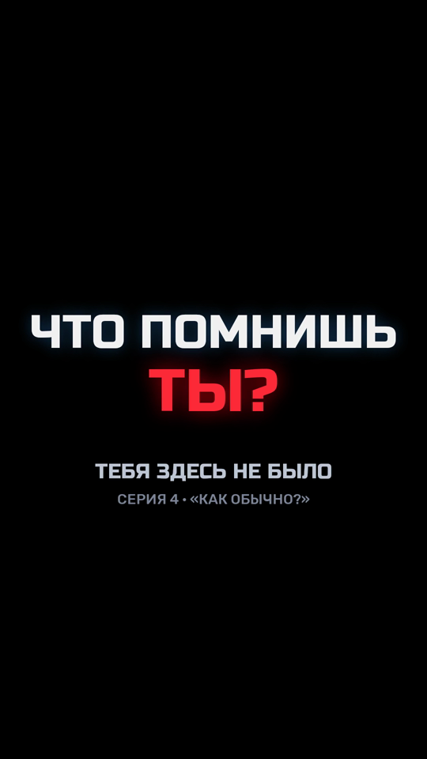

- **Локация:** Титр
- **Персонажи:** —
- **План:** титр · **Камера:** — · **Движение:** глитч-появление
- **Действие:** «ЧТО ПОМНИШЬ ТЫ?» + название серии
- **Эмоции:** вопрос зрителю
- **Диалог:** —
- **Звук:** пианино + мотив
- **Свет:** —
- **Переход:** конец
- **Способ:** процедурная 2.5D-анимация (skia, риг scripts/engine/rig2.py, кафе, улица, комната наблюдения engine/sets4.py, стандарт серии), нативные 60 fps · **Исходник:** `scripts/ep04_shots.py::s20`
