# Серия 01 «НЕ ОТВЕЧАЙ» — раскадровка и shot list

Хронометраж: 63.40 с · 1080×1920 · 60 fps · 23 кадров

## S01 · 00:00.00–00:04.40 (4.4 с) — ECU телефон: уведомление → перевод фокуса на маму

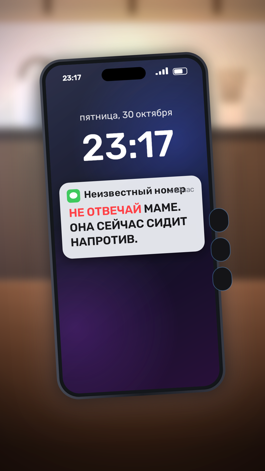

- **Локация:** Кухня (восток) + инсерт
- **Персонажи:** Арман (руки), Мама (фон)
- **План:** ДКП телефона → КП мамы · **Камера:** из-за плеча Армана, на уровне стола · **Движение:** перевод фокуса + наклон вниз
- **Действие:** Телефон загорается, падает уведомление; фокус уходит на маму с кружкой
- **Эмоции:** тревожная тишина / мама спокойна
- **Диалог:** —
- **Звук:** щелчок пробуждения, пинг, вибро
- **Свет:** тёплая лампа, свет экрана
- **Переход:** склейка
- **Способ:** процедурная 2.5D-анимация (skia, риг scripts/engine/rig.py), нативные 60 fps · **Исходник:** `scripts/ep01_shots.py::s01`

## S02 · 00:04.40–00:09.60 (5.2 с) — Двухшотовый средний план за столом: «Мам, ты мне писала?»

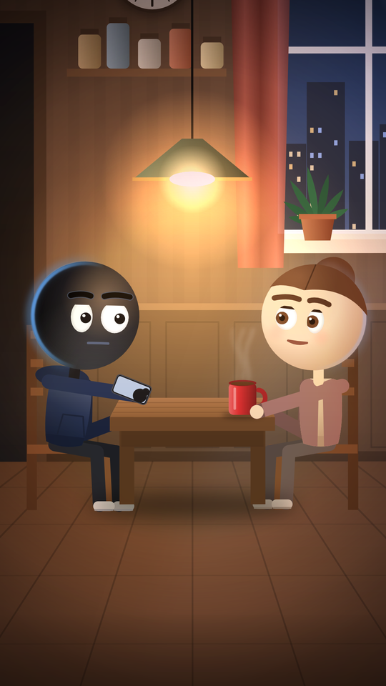

- **Локация:** Кухня (общий)
- **Персонажи:** Арман, Мама
- **План:** двухшотовый средний · **Камера:** сбоку, через стол · **Движение:** медленный наезд
- **Действие:** Арман поднимает голову; мама ставит кружку; Арман протягивает телефон
- **Эмоции:** недоумение / тепло→интерес
- **Диалог:** arman: Мам… ты мне писала? / mom: Нет. Что случилось?
- **Звук:** стук кружки, шорох одежды, скрип стула
- **Свет:** тёплый ключ от лампы, холодный контур от окна
- **Переход:** склейка по действию
- **Способ:** процедурная 2.5D-анимация (skia, риг scripts/engine/rig.py), нативные 60 fps · **Исходник:** `scripts/ep01_shots.py::s02`

## S03 · 00:09.60–00:11.90 (2.3 с) — КП мамы через плечо Армана: читает сообщение, улыбка гаснет

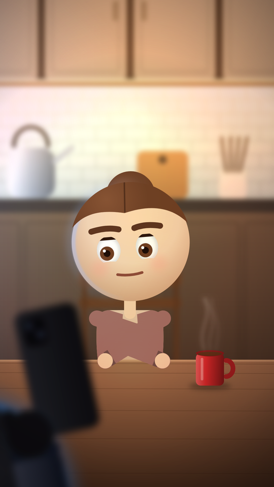

- **Локация:** Кухня (восток)
- **Персонажи:** Мама, Арман (плечо, телефон)
- **План:** КП через плечо · **Камера:** за Арманом · **Движение:** лёгкий наезд
- **Действие:** Мама читает (глаза бегают), улыбка гаснет
- **Эмоции:** тепло → тревога
- **Диалог:** —
- **Звук:** мигание лампы
- **Свет:** тёплый, лёгкое мерцание
- **Переход:** match cut на телефон
- **Способ:** процедурная 2.5D-анимация (skia, риг scripts/engine/rig.py), нативные 60 fps · **Исходник:** `scripts/ep01_shots.py::s03`

## S04 · 00:11.90–00:14.40 (2.5 с) — Инсерт: входящий звонок «МАМА»

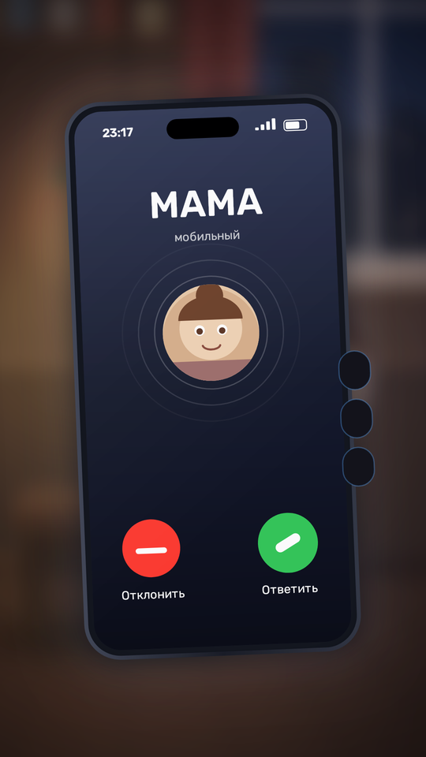

- **Локация:** Инсерт
- **Персонажи:** телефон
- **План:** деталь · **Камера:** сверху-спереди · **Движение:** микро-наезд, вибрация
- **Действие:** Входящий «МАМА»
- **Эмоции:** шок
- **Диалог:** —
- **Звук:** рингтон + вибро
- **Свет:** экран, расфокус кухни
- **Переход:** звуковой мост
- **Способ:** процедурная 2.5D-анимация (skia, риг scripts/engine/rig.py), нативные 60 fps · **Исходник:** `scripts/ep01_shots.py::s04`

## S05 · 00:14.40–00:17.90 (3.5 с) — СКП Армана: «Это что, прикол какой-то?»

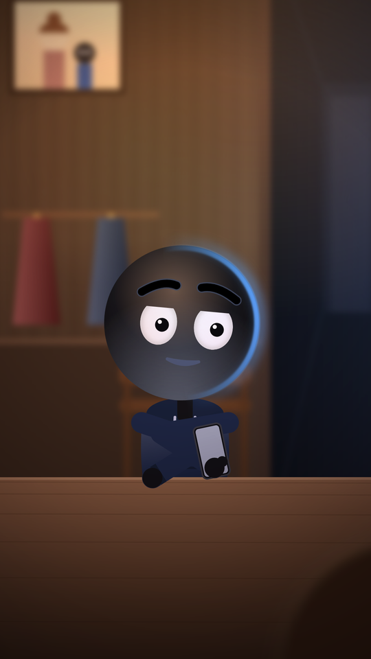

- **Локация:** Кухня (запад)
- **Персонажи:** Арман, Мама (плечо)
- **План:** СКП · **Камера:** за мамой · **Движение:** лёгкий наезд
- **Действие:** Арман смотрит то на телефон, то на маму, нервно улыбается
- **Эмоции:** нервная ирония
- **Диалог:** arman: Это что… прикол какой-то?
- **Звук:** рингтон (тише)
- **Свет:** тёплый + подсветка экрана снизу
- **Переход:** склейка
- **Способ:** процедурная 2.5D-анимация (skia, риг scripts/engine/rig.py), нативные 60 fps · **Исходник:** `scripts/ep01_shots.py::s05`

## S06 · 00:17.90–00:19.80 (1.9 с) — КП мамы: «Не отвечай»

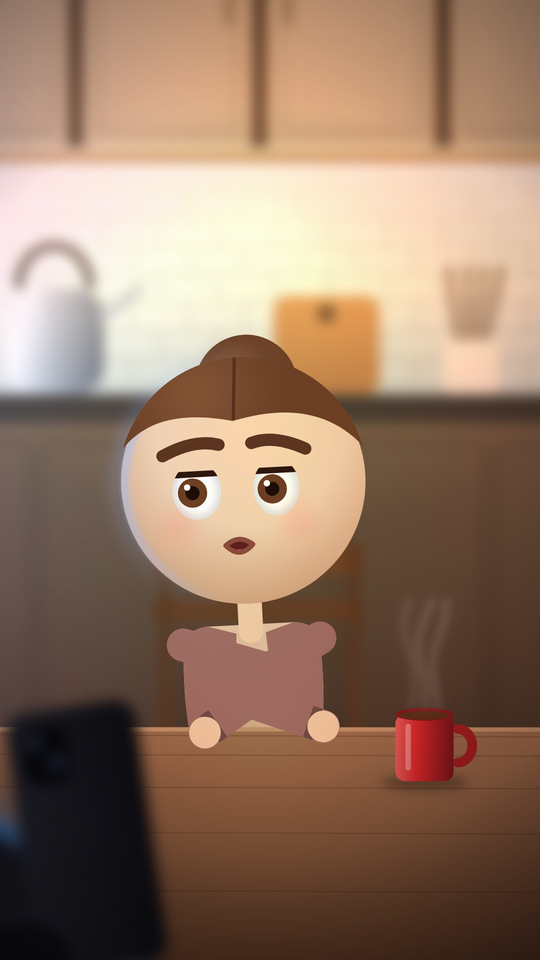

- **Локация:** Кухня (восток)
- **Персонажи:** Мама
- **План:** КП · **Камера:** за Арманом · **Движение:** наезд
- **Действие:** Мама наклоняется, говорит тихо
- **Эмоции:** скрытая тревога
- **Диалог:** mom: Не отвечай.
- **Звук:** рингтон, гул лампы
- **Свет:** мерцание
- **Переход:** склейка
- **Способ:** процедурная 2.5D-анимация (skia, риг scripts/engine/rig.py), нативные 60 fps · **Исходник:** `scripts/ep01_shots.py::s06`

## S07 · 00:19.80–00:21.10 (1.3 с) — КП Армана: «Почему?»

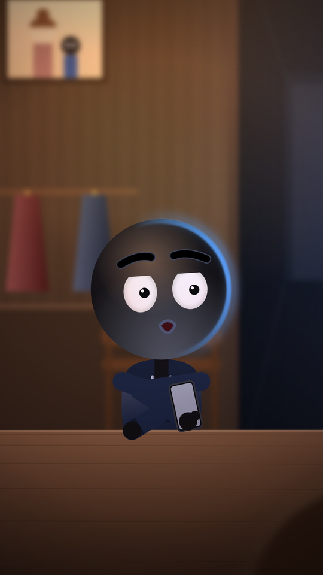

- **Локация:** Кухня (запад)
- **Персонажи:** Арман
- **План:** КП · **Камера:** за мамой · **Движение:** статично
- **Действие:** «Почему?»
- **Эмоции:** растерянность
- **Диалог:** arman: Почему?
- **Звук:** рингтон
- **Свет:** тёплый
- **Переход:** склейка
- **Способ:** процедурная 2.5D-анимация (skia, риг scripts/engine/rig.py), нативные 60 fps · **Исходник:** `scripts/ep01_shots.py::s07`

## S08 · 00:21.10–00:24.50 (3.4 с) — КП мамы: «Потому что я тоже ответила»

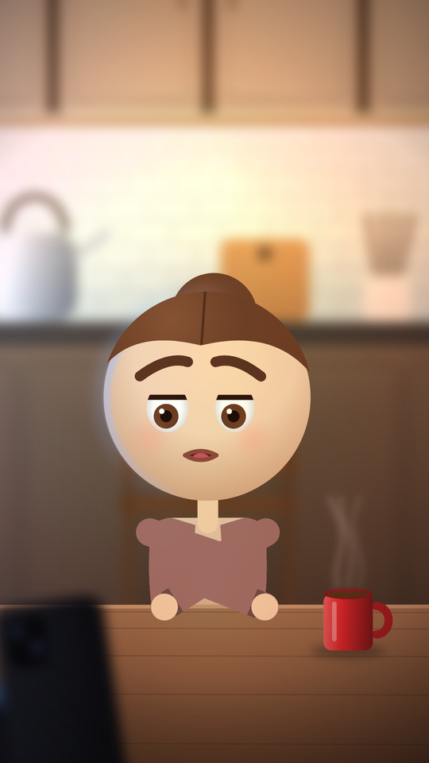

- **Локация:** Кухня (восток)
- **Персонажи:** Мама
- **План:** КП · **Камера:** за Арманом · **Движение:** медленный наезд
- **Действие:** Опускает глаза на телефон, потом на него
- **Эмоции:** грусть
- **Диалог:** mom: Потому что я тоже… ответила.
- **Звук:** рингтон, начало треска лампы
- **Свет:** свет начинает холодеть
- **Переход:** звук мерцания до склейки
- **Способ:** процедурная 2.5D-анимация (skia, риг scripts/engine/rig.py), нативные 60 fps · **Исходник:** `scripts/ep01_shots.py::s08`

## S09 · 00:24.50–00:26.90 (2.4 с) — Общий: мигание света, мама исчезает

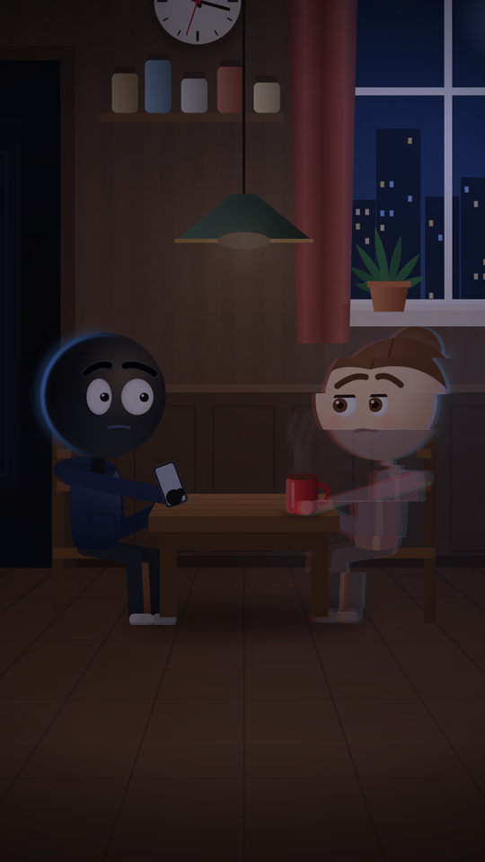

- **Локация:** Кухня (общий)
- **Персонажи:** Арман, Мама
- **План:** общий · **Камера:** сбоку · **Движение:** тряска камеры
- **Действие:** Лампа мигает, мама рассыпается глитчем и исчезает; Арман отшатывается
- **Эмоции:** ужас
- **Диалог:** —
- **Звук:** треск, глитч, суб-удар
- **Свет:** стробоскоп → холодный
- **Переход:** склейка
- **Способ:** процедурная 2.5D-анимация (skia, риг scripts/engine/rig.py), нативные 60 fps · **Исходник:** `scripts/ep01_shots.py::s09`

## S10 · 00:26.90–00:28.70 (1.8 с) — КП Армана: «Мам?»

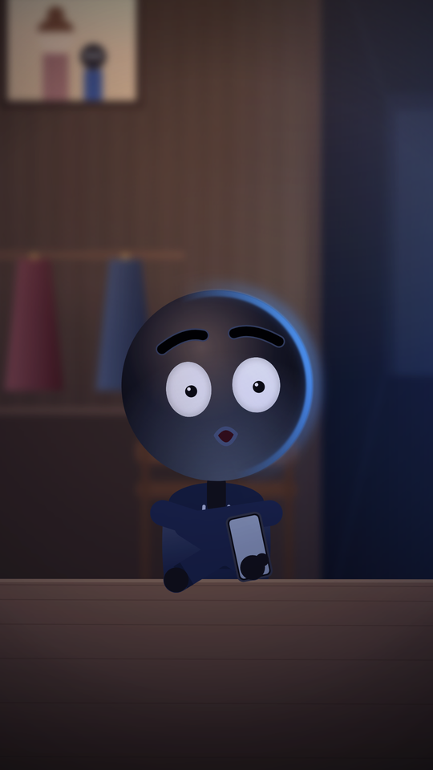

- **Локация:** Кухня (запад)
- **Персонажи:** Арман
- **План:** КП · **Камера:** за пустым стулом · **Движение:** медленный наезд
- **Действие:** «Мам?» — смотрит на пустое место
- **Эмоции:** страх
- **Диалог:** arman: Мам?
- **Звук:** рингтон продолжается
- **Свет:** холодный
- **Переход:** склейка
- **Способ:** процедурная 2.5D-анимация (skia, риг scripts/engine/rig.py), нативные 60 fps · **Исходник:** `scripts/ep01_shots.py::s10`

## S11 · 00:28.70–00:30.30 (1.6 с) — POV: пустой стул, пар от кружки

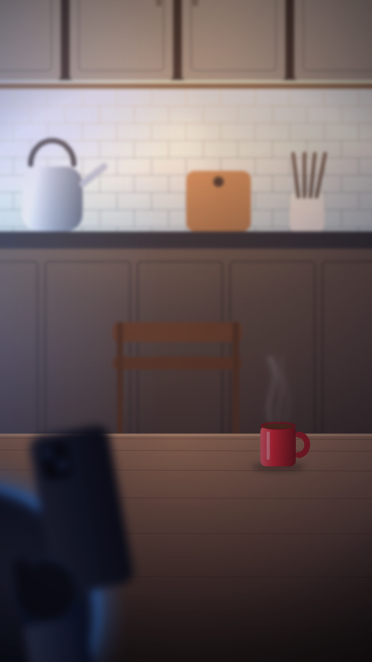

- **Локация:** Кухня (восток)
- **Персонажи:** — (пустой стул)
- **План:** POV · **Камера:** глазами Армана · **Движение:** наезд
- **Действие:** Пустой стул, пар от кружки ещё идёт
- **Эмоции:** пустота
- **Диалог:** —
- **Звук:** рингтон, тиканье
- **Свет:** холодный
- **Переход:** склейка
- **Способ:** процедурная 2.5D-анимация (skia, риг scripts/engine/rig.py), нативные 60 fps · **Исходник:** `scripts/ep01_shots.py::s11`

## S12 · 00:30.30–00:32.00 (1.7 с) — Инсерт: палец нажимает «Ответить»

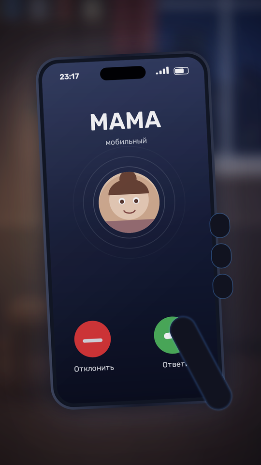

- **Локация:** Инсерт
- **Персонажи:** телефон, палец
- **План:** деталь · **Камера:** сверху · **Движение:** статично
- **Действие:** Палец нажимает «Ответить» — звонок обрывается
- **Эмоции:** решимость
- **Диалог:** —
- **Звук:** тап, тишина
- **Свет:** экран
- **Переход:** резкая тишина
- **Способ:** процедурная 2.5D-анимация (skia, риг scripts/engine/rig.py), нативные 60 fps · **Исходник:** `scripts/ep01_shots.py::s12`

## S13 · 00:32.00–00:36.20 (4.2 с) — СКП Армана с телефоном у уха: мама по телефону

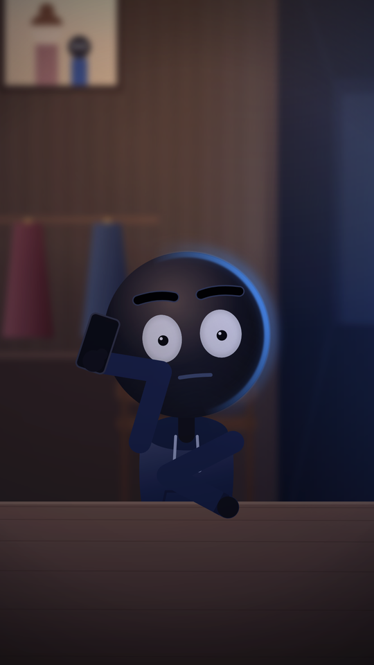

- **Локация:** Кухня (запад)
- **Персонажи:** Арман
- **План:** СКП · **Камера:** фронтально · **Движение:** наезд
- **Действие:** Телефон к уху; голос мамы из трубки
- **Эмоции:** шок
- **Диалог:** mom_phone: Сынок, я задерживаюсь. Буду через полчаса.
- **Звук:** голос в телефонной обработке
- **Свет:** холодный
- **Переход:** склейка
- **Способ:** процедурная 2.5D-анимация (skia, риг scripts/engine/rig.py), нативные 60 fps · **Исходник:** `scripts/ep01_shots.py::s13`

## S14 · 00:36.20–00:38.90 (2.7 с) — КП Армана: «Ты же только что здесь сидела»

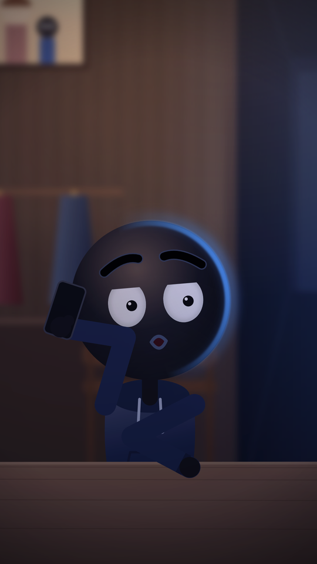

- **Локация:** Кухня (запад)
- **Персонажи:** Арман
- **План:** КП · **Камера:** фронтально · **Движение:** наезд
- **Действие:** «Ты же только что здесь сидела» — дрожит
- **Эмоции:** недоверие
- **Диалог:** arman: Ты же… только что здесь сидела.
- **Звук:** тиканье
- **Свет:** холодный
- **Переход:** склейка
- **Способ:** процедурная 2.5D-анимация (skia, риг scripts/engine/rig.py), нативные 60 fps · **Исходник:** `scripts/ep01_shots.py::s14`

## S15 · 00:38.90–00:42.70 (3.8 с) — Общий с наездом на пустой стул: «Я ещё на работе»

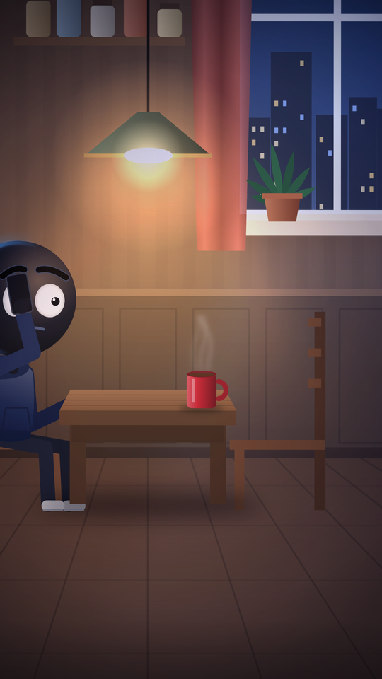

- **Локация:** Кухня (общий)
- **Персонажи:** Арман
- **План:** общий → средний · **Камера:** сбоку · **Движение:** наезд на пустой стул
- **Действие:** «Я ещё на работе»; Арман опускает телефон
- **Эмоции:** оцепенение
- **Диалог:** mom_phone: Арман, я ещё на работе.
- **Звук:** гудки конца звонка
- **Свет:** холодный, тёплая лампа слабее
- **Переход:** склейка
- **Способ:** процедурная 2.5D-анимация (skia, риг scripts/engine/rig.py), нативные 60 fps · **Исходник:** `scripts/ep01_shots.py::s15`

## S16 · 00:42.70–00:45.30 (2.6 с) — Инсерт чат: «ТЫ ОТВЕТИЛ. ТЕПЕРЬ У НАС ПРОБЛЕМА»

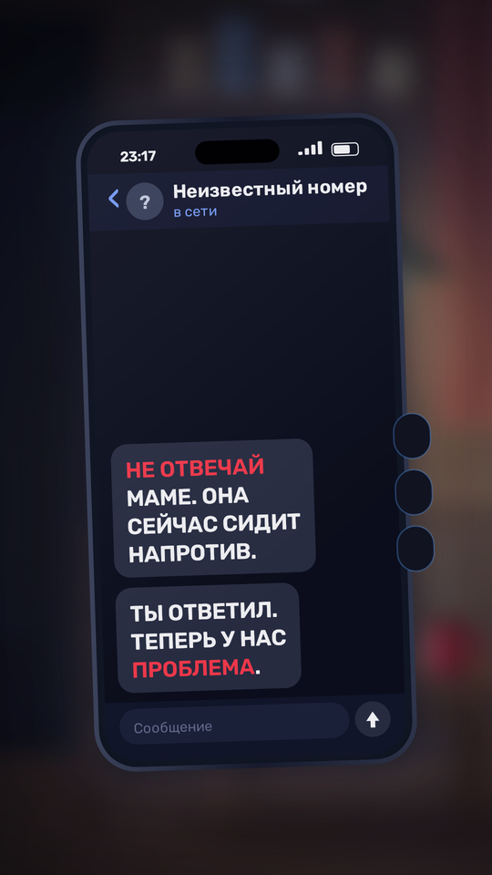

- **Локация:** Инсерт
- **Персонажи:** телефон
- **План:** деталь · **Камера:** сверху · **Движение:** микро-наезд
- **Действие:** Новое сообщение: «ТЫ ОТВЕТИЛ. ТЕПЕРЬ У НАС ПРОБЛЕМА.»
- **Эмоции:** угроза
- **Диалог:** —
- **Звук:** вибро, поп
- **Свет:** экран
- **Переход:** склейка
- **Способ:** процедурная 2.5D-анимация (skia, риг scripts/engine/rig.py), нативные 60 fps · **Исходник:** `scripts/ep01_shots.py::s16_18`

## S17 · 00:45.30–00:48.30 (3.0 с) — Инсерт: печатает «КТО ТЫ?»

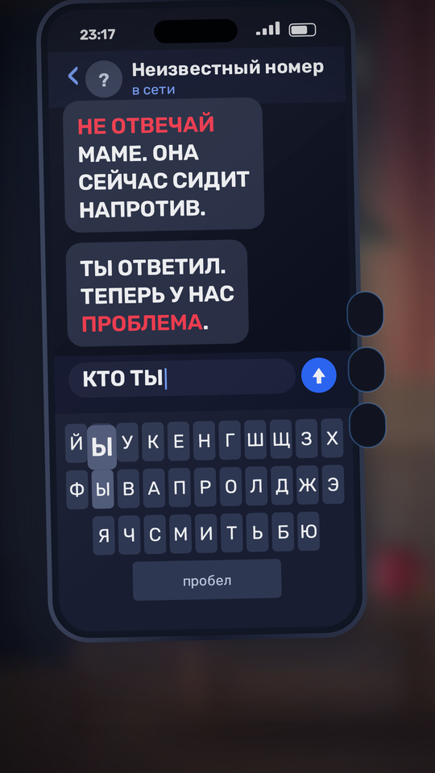

- **Локация:** Инсерт
- **Персонажи:** телефон
- **План:** деталь клавиатуры · **Камера:** сверху · **Движение:** статично
- **Действие:** Печатает «КТО ТЫ?», шёпот, отправка
- **Эмоции:** напряжение
- **Диалог:** arman: Кто… ты?
- **Звук:** тапы клавиш, свуш
- **Свет:** экран
- **Переход:** склейка
- **Способ:** процедурная 2.5D-анимация (skia, риг scripts/engine/rig.py), нативные 60 fps · **Исходник:** `scripts/ep01_shots.py::s16_18`

## S18 · 00:48.30–00:51.50 (3.2 с) — Инсерт: «ТЫ. ТОЛЬКО Я УЖЕ ПРОХОДИЛ ЭТО»

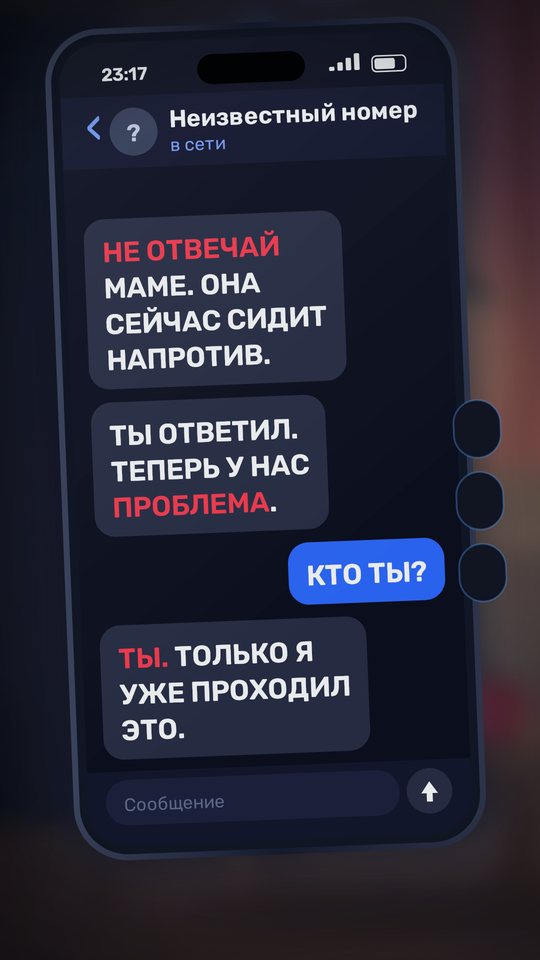

- **Локация:** Инсерт
- **Персонажи:** телефон
- **План:** деталь · **Камера:** сверху · **Движение:** медленный наезд
- **Действие:** «печатает…» → «ТЫ. ТОЛЬКО Я УЖЕ ПРОХОДИЛ ЭТО.»
- **Эмоции:** шок
- **Диалог:** —
- **Звук:** поп, сердцебиение
- **Свет:** экран
- **Переход:** склейка
- **Способ:** процедурная 2.5D-анимация (skia, риг scripts/engine/rig.py), нативные 60 fps · **Исходник:** `scripts/ep01_shots.py::s16_18`

## S19 · 00:51.50–00:54.20 (2.7 с) — ДКП глаз Армана; голос из коридора «Не верь ему»

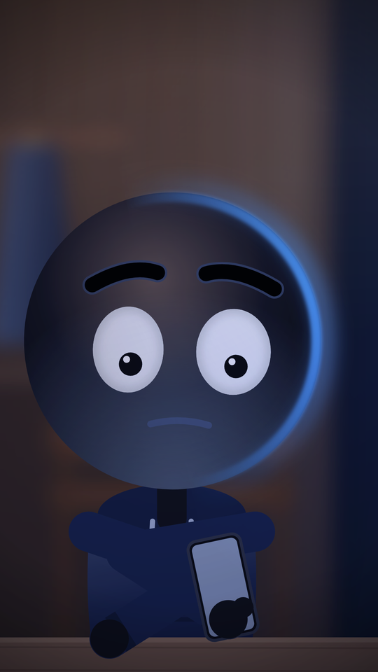

- **Локация:** Кухня (запад)
- **Персонажи:** Арман
- **План:** ДКП глаз · **Камера:** фронтально · **Движение:** медленный наезд
- **Действие:** Музыка исчезает; голос из коридора; глаза резко вправо
- **Эмоции:** ужас, оцепенение
- **Диалог:** double: Не верь ему.
- **Звук:** тишина, тиканье, голос с реверберацией
- **Свет:** холодный + красный отсвет из коридора
- **Переход:** склейка
- **Способ:** процедурная 2.5D-анимация (skia, риг scripts/engine/rig.py), нативные 60 fps · **Исходник:** `scripts/ep01_shots.py::s19`

## S20 · 00:54.20–00:55.70 (1.5 с) — Арман резко оборачивается

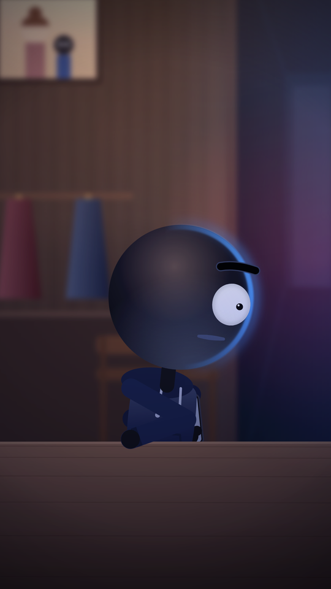

- **Локация:** Кухня (запад)
- **Персонажи:** Арман
- **План:** КП · **Камера:** фронтально · **Движение:** whip pan вправо
- **Действие:** Упреждающий присед → резкий поворот головы
- **Эмоции:** испуг
- **Диалог:** arman: Ч-что?..
- **Звук:** свист, скрип стула, вдох
- **Свет:** холодный → красный
- **Переход:** whip pan → коридор
- **Способ:** процедурная 2.5D-анимация (skia, риг scripts/engine/rig.py), нативные 60 fps · **Исходник:** `scripts/ep01_shots.py::s20`

## S21 · 00:55.70–00:59.90 (4.2 с) — Коридор: двойник с красным контуром «Он всегда пишет первым»

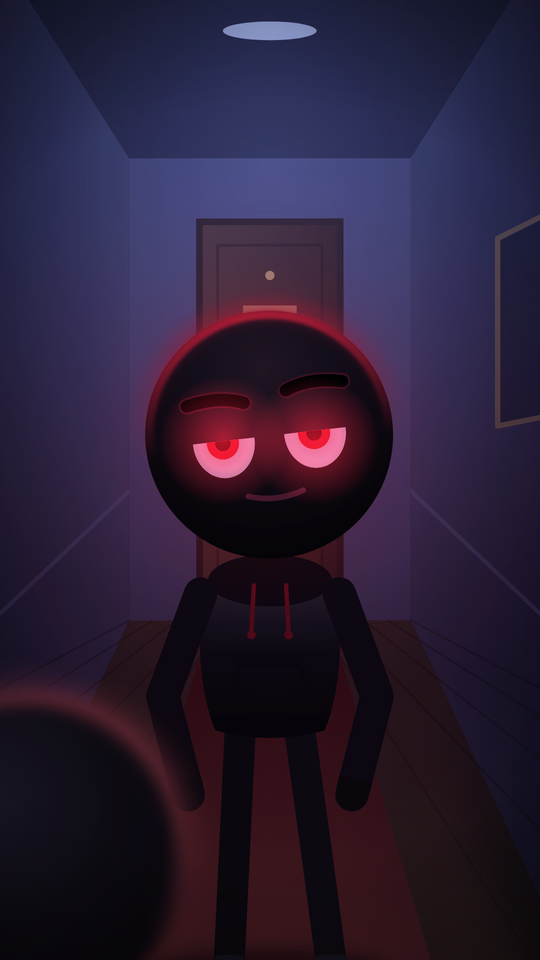

- **Локация:** Коридор
- **Персонажи:** Двойник, Арман (затылок)
- **План:** средний через плечо · **Камера:** из кухни в коридор · **Движение:** медленный наезд
- **Действие:** Двойник стоит, делает шаг, наклоняет голову, ухмыляется
- **Эмоции:** спокойная угроза
- **Диалог:** double: Он всегда пишет… первым.
- **Звук:** суб-бум, шаг, кластер
- **Свет:** холодная лампа + красный контур
- **Переход:** жёсткая склейка в чёрное
- **Способ:** процедурная 2.5D-анимация (skia, риг scripts/engine/rig.py), нативные 60 fps · **Исходник:** `scripts/ep01_shots.py::s21`

## S22 · 00:59.90–01:00.20 (0.3 с) — Резкая склейка в чёрный

- **Локация:** —
- **Персонажи:** —
- **План:** чёрный · **Камера:** — · **Движение:** —
- **Действие:** Резкий обрыв
- **Эмоции:** —
- **Диалог:** —
- **Звук:** абсолютная тишина
- **Свет:** —
- **Переход:** склейка
- **Способ:** процедурная 2.5D-анимация (skia, риг scripts/engine/rig.py), нативные 60 fps · **Исходник:** `scripts/ep01_shots.py::s22`

## S23 · 01:00.20–01:03.40 (3.2 с) — Титр «А КОМУ БЫ ПОВЕРИЛ ТЫ?»

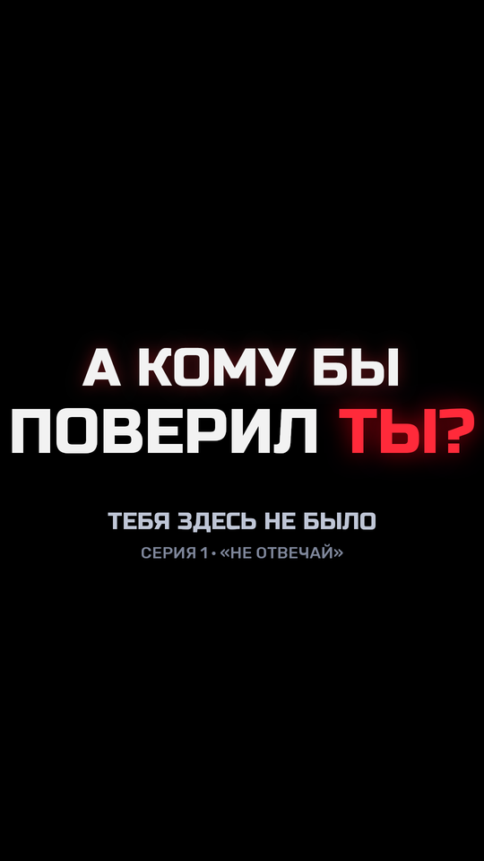

- **Локация:** Титр
- **Персонажи:** —
- **План:** титр · **Камера:** — · **Движение:** глитч-появление
- **Действие:** «А КОМУ БЫ ПОВЕРИЛ ТЫ?» + название серии
- **Эмоции:** вопрос зрителю
- **Диалог:** —
- **Звук:** низкий удар + мотив музыкальной шкатулки
- **Свет:** чёрный, красный акцент
- **Переход:** конец
- **Способ:** процедурная 2.5D-анимация (skia, риг scripts/engine/rig.py), нативные 60 fps · **Исходник:** `scripts/ep01_shots.py::s23`
